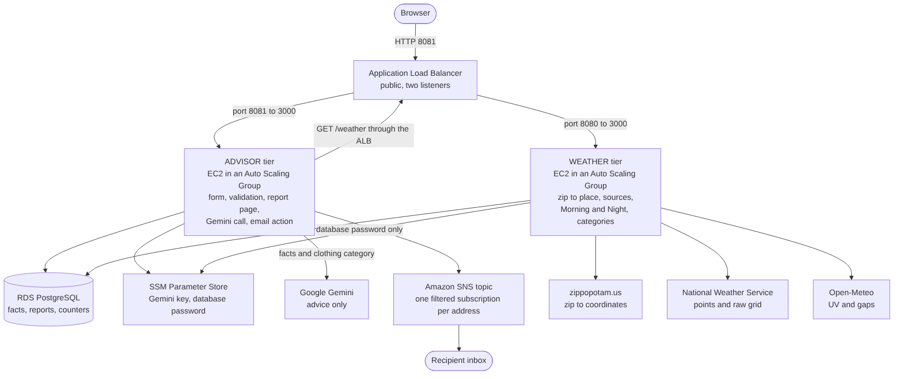

# Final Project: Weather Advisor Application
# Name: Vishnu Upadhya

The sections follow the order of the deliverables in Section 13 of the project brief.

---

## 1. Architecture document

### 1.1 Overview

The Weather Advisor is the lab06 application, extended. A visitor enters a date, a US zip code, a gender choice and an email address. The application returns a report with a Morning column and a Night column. Each column has seven facts (temperature, wind speed, visibility, UV, humidity, rain and snow) and three pieces of advice (road conditions, dressing and accessories), which are the ten items of the brief. A button on the report page sends the report to the email address through Amazon SNS.

The facts come only from weather services. The Rain and Snow categories come only from code. The advice comes from Google Gemini, or from rules in the code when Gemini cannot be used.

The two Node.js (Express) apps of lab06 were extended in place: `weather-app/app.js` and `advisor-app/app.js`. All deployment code is Python, as in lab06: the `stack/` package, the boot script that starts the app on each instance, the create and delete scripts, `budget.py` and the infrastructure tests. There is no bash in the project. The lab06 boot script was bash, and it was replaced by a Python boot script.



### 1.2 Components and responsibilities

| Component | Responsibility | Must not do | How the design keeps the rule |
|---|---|---|---|
| ALB | Public entry point with two listeners (8081 advisor, 8080 weather), health checks on `/` | Expose the app instances directly | The app security group accepts port 3000 only from the ALB security group. An integration test connects to the instance addresses directly and expects no answer |
| Advisor tier | Form, validation, report page, asking the weather tier for facts, asking Gemini for advice, checking the answer, the email action | Talk to the weather APIs, hold weather credentials | `advisor-app/app.js` has no weather API address. Its only source of facts is `WEATHER_URL` |
| Weather tier | Turn a zip code and a date into facts for Morning and Night, from the sources, with caching | Call Gemini, send email, know the gender or the email address | `weather-app/app.js` takes only `zip` and `date`. Its role has one permission (read the database password) |
| RDS PostgreSQL | Table `facts` (cache of facts by zip and day), table `reports` (saved reports), table `counters` (rate limits, caps, usage counts) | Keep personal data longer than needed | No email address is ever written. Every row is removed after its time limit (section 1.6) |
| SSM Parameter Store | Holds the Gemini key and the database password as SecureString values | Be readable by a role that does not need it | The Gemini key is readable only by the advisor role, by exact ARN |
| Gemini API | Writes the three advice items from the facts | Supply any measured number | The prompt has only facts and a clothing category. An answer that contains a digit is rejected |
| Amazon SNS | Delivers the report to a confirmed address | Deliver one person's report to another person | One subscription per address, with a filter policy on a hash of the address (section 1.8) |
| Python stack code | Creates and deletes every AWS resource, idempotently | Contain a shell command or a hand-run step | The create and delete code only calls boto3. The boot script is Python and starts `dnf`, `npm` and `systemctl` with `subprocess.run` and no shell |

The two tiers were kept. They scale separately, they have separate IAM roles, and a failure of the weather tier leaves the form and the saved reports working. A merge into one tier would lose these three things.

### 1.3 Request flow: building a report

| Step | What happens | Where |
|---|---|---|
| 1 | The visitor submits date, zip code, gender and email | Browser to advisor tier |
| 2 | The advisor checks every field on the server. A bad field ends the request with a clear message and no outside call | Advisor tier |
| 3 | If a saved report for the same zip code, date and clothing category is less than one hour old, it is shown at once | Advisor tier, RDS |
| 4 | Otherwise the advisor asks the weather tier: `GET /weather?zip=...&date=...` | Advisor tier to weather tier |
| 5 | The weather tier looks the zip code up, asks NWS for the time zone and the grid, gets the raw grid from NWS and the hourly values from Open-Meteo, picks the Morning and Night hours in local time, computes the seven facts and the Rain and Snow categories, saves the result and returns it | Weather tier, outside APIs, RDS |
| 6 | The advisor checks the Gemini caps (per day and per minute) with one atomic SQL statement, then sends Gemini the facts and the clothing category. The email address, the zip code and the city are not sent | Advisor tier to Gemini |
| 7 | The advisor checks the answer (exact keys, text only, 10 to 300 characters, no digits, no markup, no links). If it is not usable, rule-based advice is used and labeled | Advisor tier |
| 8 | The report is shown. Every fact shows its source, and the page says who wrote the advice. A report with advice from Gemini is saved for one hour | Advisor tier, RDS |

### 1.4 Request flow: emailing a report

| Step | What happens |
|---|---|
| 1 | The visitor presses "Email this report" on the report page |
| 2 | The advisor checks every field again, and checks that this visitor has not made more than 5 email requests in the hour |
| 3 | The advisor looks for a subscription of the address on the SNS topic. If there is none, or it is still pending, it asks SNS to subscribe the address. SNS sends the confirmation message, the page says "Waiting for confirmation", and the report is not sent |
| 4 | When the subscription is confirmed, the report is published with the attribute `recipient` set to a hash of the address. Only the subscription of that address accepts it |
| 5 | The visitor sees one of: accepted for delivery, waiting for confirmation, too many requests, or not sent |

The report that is mailed is built again on the server from the checked fields. The browser does not supply the text. The email address is used for this one purpose. It is never sent to Gemini, never written to a log and never stored in the database.

### 1.5 Data classification (Section 4.4)

| Kind | Items | Source | Why |
|---|---|---|---|
| Measured or forecast values | Temperature, wind speed and gusts, visibility, UV, humidity, chance and amount of rain and snow | Weather APIs only: NWS first, Open-Meteo for UV and for gaps | A language model can invent a plausible number |
| Derived categories | Rain: Heavy, Mild or No. Snow: Heavy, Mild or No | Code in `weather-app/app.js` (`rainCategory`, `snowCategory`), with the thresholds of section 3.3 | The same data always gives the same category, and it can be tested |
| Advice | Road conditions, dressing, accessories | Gemini, or the rule-based fallback, always labeled | A model turns numbers into practical suggestions |
| Personal data | Email address | Typed by the visitor. Held only by SNS as a subscription. Not in the database, not in a log | Needed only to deliver mail |
| Personal data | Gender choice | Chosen from a fixed list and turned into a clothing category. Not stored with the email address, not logged | Used only to tailor the clothing suggestion |
| Visitor identity | Hash of the network address | Only inside the rate limit counters, which expire after two minutes or two hours | Abuse control |

### 1.6 What is cached and for how long

| Data | Table and key | Fresh for | Removed after | Why |
|---|---|---|---|---|
| Facts | `facts`, zip code and day | 30 minutes (`CACHE_SECONDS`) | 6 hours (`STALE_SECONDS`) | NWS updates its gridded forecast about once an hour, so 30 minutes is recent enough and saves most outside calls. An older copy is used only when the weather sources fail, and its age is shown |
| Saved report | `reports`, zip code, day and clothing category | 1 hour (`REPORT_SECONDS`) | 1 hour | The same question is not answered twice, which saves Gemini calls. Only reports with advice from Gemini are saved |
| Counters | `counters`, name and time window | the window | two windows | Rate limits, caps and the usage counts |

The database has backups turned off, as in lab06.

### 1.7 Per-tier IAM permissions (Section 7.2)

The policy documents are built by `stack/wpolicies.py`. There are no wildcard actions and no wildcard resources, and a unit test fails if a `*` appears.

| Role | Action | Resource | Line of code that needs it |
|---|---|---|---|
| Weather tier | `ssm:GetParameter` | the database password parameter | `weather-app/app.js` line 384, in `readDbPassword` |
| Advisor tier | `ssm:GetParameter` | the Gemini key parameter | `advisor-app/app.js` line 128, in `getApiKey` |
| Advisor tier | `ssm:GetParameter` | the database password parameter | `advisor-app/app.js` line 323, in `readDbPassword` |
| Advisor tier | `sns:ListSubscriptionsByTopic` | the one topic ARN | `advisor-app/app.js` line 429, in `findSubscription` |
| Advisor tier | `sns:Subscribe` | the one topic ARN | `advisor-app/app.js` line 438, in `subscribe` |
| Advisor tier | `sns:Publish` | the one topic ARN | `advisor-app/app.js` line 443, in `publish` |

The weather role cannot read the Gemini key and cannot use SNS. The advisor role cannot delete the topic and cannot change a parameter. The integration tests check these with the IAM policy simulator.

### 1.8 Email design (Section 8)

Amazon SNS was chosen (decision 10). The six questions of the brief are answered here.

1. **Consent.** SNS sends a confirmation message to the address, and the subscription stays pending until the link is chosen. While it is pending the page says "Waiting for confirmation" and explains what to do. Pressing the button again asks SNS to send the confirmation again.
2. **Only to the person who asked.** Every address has its own subscription with the filter policy `{"recipient": ["<hash of the address>"]}`. A report is published with the message attribute `recipient` set to the hash of the address that asked, so only the matching subscription receives it. A hash is used so that the address is not placed in a message attribute.
3. **Content.** A plain text message. Each period is a block of `Label: value` lines, followed by the three advice lines. The last lines name who wrote the advice and credit the data sources. A table reads well as `Label: value` lines, so HTML is not needed.
4. **Expiry, wrong address, service unavailable.** SNS removes a subscription that is not confirmed within 48 hours, and the next request starts the process again. A wrong address never confirms, so nothing is delivered to it. If SNS returns an error, the page says the email was not sent. The page says "accepted" only after the publish call succeeded.
5. **Permissions.** `sns:ListSubscriptionsByTopic`, `sns:Subscribe` and `sns:Publish`, each on the exact topic ARN (section 1.7).
6. **Proof for two recipients.** The test `two recipients never receive each other's report` in `advisor-app/app.test.js` publishes a report for address A and one for address B, then applies the filter policy of each subscription to the attributes of each message. Each message matches only its own subscription, and the attributes do not contain the address. The filtering itself is done by AWS, so the check is repeated with two real inboxes (section 5.6).

Known limits: SNS adds its own footer to the message and the sender is an AWS address. Anyone can cause one confirmation message to be sent to an address, and the limit of 5 email requests per visitor per hour keeps this small.

### 1.9 Failure behavior (Section 9)

| Failure | What the user sees | What the system does | Test |
|---|---|---|---|
| Postal code is not a five digit US zip code | "This service covers US locations only. Enter a five digit US ZIP code, for example 60616. Postal codes from other countries are not supported." (HTTP 400) | Refused before any outside call. The input is never shown back without escaping | `bad input is refused before any outside call`, `postal codes that are not five digit US zip codes are refused` |
| Zip code is well formed but not found | "That ZIP code was not found. Check the number and try again." (HTTP 404) | Gemini is not called | `an unknown zip has its own message and Gemini is not called` |
| A weather source is slow or down | If one source fails, the report is built from the other. If both fail and a copy under 6 hours old exists, the report says "older saved data from N minutes ago is shown". Otherwise "Weather data is unavailable right now. Try again in a few minutes." (HTTP 502) | Each outside call has a 6 second limit and one retry. No value is invented | `one failing source still gives an answer`, `when the sources are down an older copy is served with its age`, `when the sources are down and nothing is saved the answer is a clear 502` |
| A field is missing for one period | "not available" with the reason in that cell. The rest of the report works | The prompt tells Gemini not to use a missing value, and the fallback rules skip it | `a missing layer is reported, not invented`, `the fallback does not rely on a value that is not available` |
| Gemini returns an error, a quota message or an unusable answer | The facts, with advice labeled "Rule-based fallback (Gemini could not be used)" | The failure is counted in `counters` and a `gemini_error` line is logged | `a Gemini error gives labeled rule-based advice and the failure is counted`, `an unusable answer from Gemini gives the fallback and is not saved` |
| The Gemini cap is reached | The same fallback, with the note "the Gemini limit for today or this minute was reached" | The atomic counter decides, and a `gemini_cap_reached` line is logged | `the Gemini cap holds when many requests race, and the rest get the fallback`, chaos test |
| The email service rejects or delays the message | "The email was not sent because the email service did not accept it. The report above is still correct." | "Accepted" is shown only after SNS accepted the message | `a failure of the email service is reported honestly` |
| An instance is terminated | The page of the other tier keeps working. A saved report is still shown | The ALB stops sending to the instance and the Auto Scaling Group starts a new one. No state is on the instance | chaos test, recovery time in section 5.5 |
| A request takes too long | A clear "unavailable" message | Limits on every outside call: 6 seconds for each weather source, 15 seconds for Gemini, 20 seconds between the tiers, 3 seconds for the database. All are under the 60 second idle timeout of the ALB | `weather-app/app.js` `fetchJson`, `advisor-app/app.js` `askGemini` and `fetchWeather` |
| The database is unavailable | The report still works. Advice is the labeled fallback, because the cap cannot be checked | The database is left alone for 30 seconds after a failure, so requests do not wait | `the service works when the database is unavailable`, `when the counters cannot be reached Gemini is not called` |

### 1.10 Decision table (Section 12)

| # | Decision | Options considered | Chosen | Why |
|---|---|---|---|---|
| 1 | Number of tiers and what each owns | One tier. Two tiers. Three tiers | Two tiers: advisor and weather | They exist in lab06 and have separate jobs, separate roles and separate scaling. A third tier was not needed |
| 1a | Application language | Extend the lab06 Node.js apps. Write the application in Python | Extend the lab06 Node.js apps | The zip lookup, the NWS calls, the database helper, the Gemini call and the fallback of lab06 were kept and extended, so the tested lab06 code was reused. The cost is a second test runner: the application logic is tested with `node --test` and the infrastructure with pytest |
| 2 | Which API supplies each output, and gaps | NWS only. NWS and Open-Meteo. Another provider | NWS raw grid first, Open-Meteo for UV and for gaps | The NWS grid has no UV layer, and some of its layers stop before day 7 (section 2). Open-Meteo is free, needs no key and covers every field for 7 days in one request |
| 3 | Zip code to coordinates, unknown zip codes | A zip table in the code. A geocoding service. zippopotam.us | zippopotam.us, as in lab06, then NWS `/points` for the time zone and the grid | Free, no key, and it answers 404 for a zip code that does not exist, which gives the "not found" case |
| 4 | Morning and Night, time zones, daylight saving | Server time. UTC. Local time of the zip code | Morning 06:00 to 11:59 and Night 18:00 to 23:59, local time of the zip code | The time zone name comes from NWS `/points`. Every forecast hour is converted with `Intl.DateTimeFormat`, so daylight saving is handled by the time zone data. Tests cover both changes of 2026 |
| 5 | Aggregation of each item | Average. Middle value. Extremes | Temperature low to high. Wind highest sustained and highest gust. Visibility lowest. UV peak. Humidity average. Rain highest chance and highest hourly rate. Snow highest chance and total | The extremes matter for clothing and for road safety (section 3.2) |
| 6 | Heavy, Mild and No | Chance only. Amount only. Both | Both, with published thresholds | The rain intensity definitions of the American Meteorological Society glossary and the heavy snow definition of the National Weather Service glossary (section 3.3) |
| 7 | What is cached | Nothing. Memory of the instance. Database | Database tables with time limits (section 1.6) | The state is outside the instances, so a replaced instance loses nothing |
| 8 | How Gemini is called and checked | Free text. JSON | JSON with a response schema, model name from `.env`, 15 second limit, at most 1000 output tokens. The answer is checked for exact keys, text type, length, and no digits, markup or links | The model cannot change a number, because no number is accepted from it |
| 9 | Fallback advice | None. One fixed sentence. Rules | Rules by temperature band, rain, snow, visibility, wind and UV (section 3.4) | The report is useful without the model, and it is labeled |
| 10 | SNS or SES, consent and privacy | SNS. SES | SNS with one filtered subscription per address | Plain text is enough, setup is small, and SNS already makes the recipient confirm. SES would give HTML, but in the sandbox the sender and every recipient must be verified, which does not fit a public page. What is lost: formatting, and the AWS footer cannot be removed |
| 11 | Per-tier IAM permissions | One shared role. One role per tier | One role per tier, exact ARNs | Section 1.7 |
| 12 | Abuse controls and their limits | None. Counters | 20 requests per visitor per minute, 5 email requests per visitor per hour, Gemini caps, saved reports, cached facts, 4 KB request limit | Section 1.11 |
| 13 | Daily cap and budget | Read then write. One atomic statement | One SQL statement: `INSERT ... ON CONFLICT ... DO UPDATE SET n = n + 1 WHERE n < limit RETURNING n` | Two requests arriving together cannot both take the last place. `budget.py` reports the hours, the Gemini calls and the cost |
| 14 | Gender in the interface, the prompt and the logs | Free text. Fixed list | A fixed list of three choices (female, male, neutral or prefer not to say). The form says it is used only for the clothing suggestion | Gemini receives only `womenswear`, `menswear` or `neutral`. The choice is not stored with the email address and is not logged |
| 15 | Database | DynamoDB, as the brief assumes. RDS PostgreSQL, as built in lab06 | RDS PostgreSQL | The lab06 of this course was built on RDS, and the project builds on lab06. Two things follow: the daily cap uses an atomic SQL statement in place of a DynamoDB atomic write, and rows are removed by a `DELETE` on each write in place of the DynamoDB time to live |

### 1.11 Threat table

| Threat | Control | What remains |
|---|---|---|
| Script injection through a form field | Strict validation of every field. Everything shown on the page goes through `escapeHtml`. A test posts `<script>` and checks it is not shown back | None known |
| Script injection through an API response or Gemini | Weather values are turned into numbers and formatted by code. The Gemini answer is rejected if it has markup, links or digits, and it is escaped as well | None known |
| SQL injection | Every query uses placeholders (`$1`, `$2`). The zip code is five digits before it reaches a query | None known |
| Prompt injection | Only fixed, checked values reach the model: the facts and a clothing category. No text typed by the visitor is sent | The model could still write odd advice. The check limits its shape and length |
| Gemini key leaked | Stored only in SSM. Readable only by the advisor role. Sent in a request header, never in a URL, a log or user-data. A test checks that it is not in user-data | The key is in memory on the advisor instance |
| One visitor uses up the Gemini free tier | Per-visitor rate limit, per-minute and daily caps, saved reports. Fallback when a cap is reached | People behind one network address share one visitor limit |
| The page is used to send mail to strangers | Email only after the recipient confirmed. 5 email requests per visitor per hour | A stranger can receive one confirmation message |
| One person receives another's report | One filtered subscription per address | The filtering is done by AWS and was checked with two real inboxes |
| Direct access to the instances | The app security group accepts port 3000 only from the ALB security group | None known |
| Database exposure | Not public. Port 5432 only from the app security group. Encrypted storage. TLS with certificate checking | Both tiers log in with the same database user |
| Forged client address to avoid the limits | Only the last entry of `X-Forwarded-For`, which the ALB adds, is used | None known |
| Personal data kept too long | The email address and the gender choice are not in the database or the logs. Every row expires | SNS holds the subscription until the topic is deleted with the stack |
| Plain HTTP | The lab uses HTTP on the ALB | Before real use, HTTPS with a certificate (section 8) |

---

## 2. Source map and API report

### 2.1 Method

1. `python3 testing/investigate_sources.py` was run for zip code 60616. It calls every source the application uses, saves each raw response in `weather-app/fixtures/real/`, prints which hours of Morning and Night each field covers on each of the seven days, and writes the table to `source_map_evidence.md`. It also asks for the unknown zip code `00000`.
2. The field names, units and example values in the evidence table were read from the saved responses.
3. The same saved responses are fed to the parsing code by the contract tests in `weather-app/app.test.js`, so the code is proved against what the services really send.

### 2.2 The source map (Section 5.1)

| # | Output | First source, endpoint and field | Second source and field | Resolution | Gap handling |
|---|---|---|---|---|---|
| 1 | Temperature | NWS `/gridpoints/{office}/{x},{y}`, layer `temperature` | Open-Meteo `/v1/forecast`, `temperature_2m` | Hourly | The second source is used when NWS covers fewer than 3 of the 6 hours of the period. If neither has a value: "not available" with the reason |
| 2 | Wind speed | NWS layers `windSpeed` and `windGust` | Open-Meteo `wind_speed_10m` and `wind_gusts_10m` | Hourly | The same rule. If no source has gusts, the gust is left out of the text |
| 3 | Visibility | NWS layer `visibility` | Open-Meteo `visibility` | Hourly | The same rule |
| 4 | UV | none: the NWS grid has no UV layer | Open-Meteo `uv_index` | Hourly | "not available" with the reason |
| 5 | Humidity | NWS layer `relativeHumidity` | Open-Meteo `relative_humidity_2m` | Hourly | The same rule |
| 6 | Rain (Heavy, Mild, No) | NWS layers `probabilityOfPrecipitation` and `quantitativePrecipitation` | Open-Meteo `precipitation_probability` and `precipitation` | NWS amounts cover several hours, Open-Meteo is hourly | Section 3.3 says what happens when only the chance or only the amount is known |
| 7 | Snow (Heavy, Mild, No) | NWS layers `probabilityOfPrecipitation` and `snowfallAmount` | Open-Meteo `precipitation_probability` and `snowfall` | The same | The same |
| 8 to 10 | Road conditions, dressing, accessories | Gemini, from the facts | Rule-based fallback | One answer per period | Labeled with who wrote it |

The same table applies to Morning and Night, because both periods are taken from the same hourly data. The evidence, the horizon and the hours covered for each period are in the table below.

### 2.3 Evidence from the real responses

*(Paste the content of `source_map_evidence.md` here after running `python3 testing/investigate_sources.py`.)*

📸 Screenshot: the output of `python3 testing/investigate_sources.py`.

### 2.4 Questions the investigation must answer (Section 5.2)

1. **What does the NWS API return for a point?** `/points/{lat},{lon}` returns the time zone (`properties.timeZone`) and three addresses: the text forecast (`forecast`), the hourly forecast (`forecastHourly`) and the raw grid (`forecastGridData`). The text forecast has named periods of about 12 hours with a temperature, a wind speed as text, a short description and a chance of precipitation. It does not have visibility, UV or snowfall amounts, and its periods do not match Morning and Night. The raw grid has one layer per measured value, with times in UTC and durations. The application uses the raw grid. *(Add one sentence with the fields of one period that the script printed.)*
2. **Does NWS provide every output for both periods up to day 7?** *(Write the gaps that the evidence table shows, for example "the visibility layer was empty" and "quantitativePrecipitation and snowfallAmount stop after day N".)* The application does not assume the answer. It counts the hours at run time and uses the second source when fewer than 3 of 6 hours are covered.
3. **For every gap, a second source.** Open-Meteo was chosen because it supplies every field of the table for seven days from one request, in the local time of the place, with no key. UV has no NWS layer, so Open-Meteo is its only source. Where neither source has a value, the report says "not available" with the reason. A missing value is never shown as zero.
4. **How does a zip code become coordinates?** `api.zippopotam.us/us/{zip}` returns the place name, the state and the latitude and longitude. For the unknown zip code `00000` it returned HTTP status *(write the status the script printed)*, which the code turns into "ZIP code not found".

### 2.5 Evaluation of each source (Section 5.3)

| Criterion | NWS (api.weather.gov) | Open-Meteo | zippopotam.us |
|---|---|---|---|
| Covers the field and the 7 day horizon | See the evidence table | See the evidence table | Not a forecast |
| Free to use, key | Free, no key. A `User-Agent` header that identifies the application is required | Free for non-commercial use, no key | Free, no key |
| Rate limits and fair use | Asks for reasonable use. Facts are cached for 30 minutes, and each visitor is limited to 20 requests per minute | A daily request limit applies to the free service. The same cache protects it | The same cache |
| Terms of use and attribution | Public domain data of the US government. The report names the National Weather Service | CC BY 4.0, credit required. The report prints "Weather data by Open-Meteo.com (CC BY 4.0)" | The report prints "Zip code lookup by zippopotam.us" |
| Reliability and how it fails | Can answer slowly or with an error. 6 second limit, one retry, then Open-Meteo or an older copy | The same, in the other direction | A failure gives "weather data is unavailable". A 404 gives "not found" |
| Units and time zones | `wmoUnit:` units (degC, km_h-1, m, mm, percent) and UTC times with durations such as `PT6H`. The code converts every unit and stops on a unit it does not know | Metric units, and local times when the `timezone` parameter is given | Coordinates as text |

### 2.6 Scope rules (Section 5.4)

- **Coverage.** Five digit US zip codes only. Any other postal code is refused on the server, before any outside call, with a message that says the service covers US locations only and gives an example. A five digit code that does not exist gets its own "ZIP code not found" message.
- **Time.** Morning, Night and the selected date are in the local time of the zip code's location.
- **Freshness.** Cached facts are fresh for 30 minutes (section 1.6).

---

## 3. Report definition

### 3.1 Periods (Section 6.1)

| Decision | Definition |
|---|---|
| Morning | 06:00 to 11:59 local time on the selected date |
| Night | 18:00 to 23:59 local time on the selected date. The period does not cross midnight |
| Local time | The time zone of the zip code's location, from the NWS `/points` response. It is not the server time and not UTC |
| Date range | Today through today plus 6 days, which is seven calendar days. "Today" is the calendar day at the zip code's location. The advisor first checks a window that is one day wider on each side, so that every US time zone is handled, and the weather tier then checks the exact window at the location |
| Today, late in the evening | Today can be chosen late in the evening. A period that has ended shows every item as "not available" with the reason "this period has already passed". The other period is shown as usual |

### 3.2 Aggregation (Section 6.2)

A period has six hours of forecast. One value or a short range is shown for each item.

| Item | What is shown | Unit | Why |
|---|---|---|---|
| Temperature | Lowest and highest of the six hours, for example "43 to 52 F" | degrees Fahrenheit | The range shows how much the temperature changes, which matters for layers. The "feels like" value is not used. The advice gets the wind speed together with the temperature |
| Wind speed | Highest sustained wind and highest gust, for example "up to 13 mph, gusts to 25 mph" | miles per hour | The strongest wind matters for roads and for clothing |
| Visibility | Lowest of the six hours | miles | The worst moment decides road safety. Under 1 mile counts as poor visibility |
| UV | Peak of the six hours, with its name on the WHO scale: Low under 3, Moderate 3 to 5.9, High 6 to 7.9, Very high 8 to 10.9, Extreme 11 and above | UV index | Sun protection depends on the peak. At night the index is 0, which is shown as "0.0 (Low)" and gives no sun advice |
| Humidity | Average of the six hours | percent | One typical value is enough for the advice |
| Rain | The highest chance of precipitation and the highest hourly amount. The category uses both | percent, inches per hour | Section 3.3 |
| Snow | The highest chance of precipitation and the total snowfall of the period | percent, inches | Snow is judged by how much builds up |

An amount that a source gives for several hours at once (for example 12 mm over 6 hours) is shared equally over those hours before the highest hourly amount and the total are calculated.

### 3.3 Heavy, Mild and No (Section 6.3)

| Category | Rain (inches per hour) | Snow (inches in the 6 hour period) |
|---|---|---|
| Heavy | more than 0.30 | 2.0 or more |
| Mild | 0.01 up to and including 0.30 | 0.1 up to 2.0 |
| No | under 0.01 | under 0.1 |

**Where the thresholds come from.** Rain: the Glossary of Meteorology of the American Meteorological Society defines rain intensity per hour as light from a trace to 0.10 inch, moderate from 0.11 to 0.30 inch, and heavy over 0.30 inch. Light and moderate are both shown as Mild. Snow: the National Weather Service glossary defines heavy snow as snowfall of 4 inches or more in 12 hours or less. A period is 6 hours, which is half of that, so 2 inches or more in the period is Heavy. A trace of 0.1 inch is the smallest amount shown as Mild.

- American Meteorological Society, Glossary of Meteorology, entry "rain": https://glossary.ametsoc.org/w/index.php?curid=4721
- National Weather Service glossary, entry "Heavy Snow": https://forecast.weather.gov/glossary.php?word=heavy+snow

**How the chance of precipitation is combined with the amount.**

1. If the chance is known and is under 20 percent, the category is No.
2. Otherwise, if an amount is known, the amount decides the category.
3. If only the chance is known, 60 percent or more gives Mild and less gives No. It is never Heavy, because the strength is not known. For snow, Mild from the chance alone also needs a low temperature of 32 F or below.
4. If neither is known, the item is "not available" with the reason.
5. The forecast amount is liquid water, which includes melted snow. When the whole period stays at or below 32 F, the precipitation is counted as snow and Rain is No.

The page shows the numbers behind a category, for example "Mild (chance 70%, 0.08 in per hour at most)".

**Boundary tests.** Rain: chances 19 and 20, amounts 0.009, 0.01, 0.30 and 0.301, and chance-only values 59 and 60. Snow: totals 0.09, 0.1, 1.99 and 2.0, and temperatures 32 and 33 for chance-only snow. They are in `weather-app/app.test.js`.

### 3.4 The three advice items (Section 6.4)

| Item | Inputs | From Gemini | From the rules (`fallbackAdvice` in `advisor-app/app.js`) |
|---|---|---|---|
| Suggested road conditions | rain, snow, temperature, visibility, wind | One or two practical sentences | Warnings for heavy or mild snow, heavy or mild rain, rain near freezing, visibility under 1 mile, and wind of 25 mph or gusts of 40 mph. Otherwise "Roads should be dry and clear" |
| Suggested dressing, based on gender | temperature, wind, humidity, rain, snow, clothing category | Clothing suited to the facts and the category | The average of the low and the high picks one of five bands (up to 32, 50, 68, 80 F, and above). Each band has a text for womenswear, menswear and neutral |
| Suggested accessories to carry | rain, snow, UV, temperature, wind | Items to carry | An umbrella for Mild rain, a waterproof jacket and an umbrella for Heavy rain, waterproof boots for snow, sunscreen and sunglasses for UV 3 or more, gloves and a scarf at 40 F or below, a windproof layer at 25 mph or more |

**Gender handled responsibly.**

- The form offers three choices: Female, Male, and Neutral or prefer not to say. It is a fixed list, never free text.
- The form says the choice is used only to tailor the clothing suggestion.
- Gemini receives a clothing category (`womenswear`, `menswear` or `neutral`), not an identity.
- The choice is not stored with the email address, and neither is logged.

---

## 4. Code

| Part | Files |
|---|---|
| The application | `weather-app/app.js`, `advisor-app/app.js`, each with its `package.json` |
| The Python stack | `stack/wconfig.py`, `stack/wclients.py`, `stack/wpolicies.py`, `stack/wstack.py`, `stack/database.py`, `stack/usage.py`, and the shared `network.py`, `balancer.py`, `compute.py`, `scaling.py`, `policies.py`, `config.py`, `clients.py`, `util.py` |
| The Python boot script | `BOOT_SCRIPT` and `build_user_data` in `stack/wstack.py` |
| Scripts to create and delete everything | `create_database.py`, `create_weather_stack.py`, `delete_weather_stack.py`, `delete_database.py` |
| Cost | `budget.py` |
| Application logic tests (Node.js) | `weather-app/app.test.js`, `advisor-app/app.test.js` |
| Infrastructure tests (pytest) | `tests/unit/test_weather_stack.py`, `tests/unit/test_weather_database.py`, `tests/unit/test_weather_budget.py` |
| Integration and chaos tests (pytest) | `tests/integration/test_weather_app.py`, `tests/integration/test_weather_infra.py`, `tests/integration/test_weather_chaos.py` |
| Helpers | `testing/app_smoke_test.py`, `testing/store_gemini_key.py`, `testing/investigate_sources.py` |

Names, ports, limits and the Gemini model name come from `.env`.

---

## 5. Test evidence

### 5.1 Tests that need no AWS account and no network

The application is Node.js, so the application logic is tested with the Node.js test runner and the infrastructure with pytest (Section 11.2).

```
python3 -m pytest -v
(cd weather-app && npm test)
(cd advisor-app && npm test)
```

📸 Screenshot: the last lines of each of the three commands, with the number of tests passed.

| Layer (Section 11.2) | Where | What is covered |
|---|---|---|
| Unit tests, application logic | `advisor-app/app.test.js` | Every validation rule and its boundaries, with a table of postal codes that must be refused (Canadian, UK, four and six digits, letters, empty, very long, full-width digits) and zip codes that must be accepted. Checking of Gemini's answer (good, malformed, wrong types, too long, digits, markup, links). Escaping of everything shown on the page. The rule-based fallback |
| Unit tests, application logic | `weather-app/app.test.js` | Period selection across time zones and both daylight saving changes of 2026. Aggregation. Rain and Snow thresholds on and around each boundary. Unit conversion |
| Unit tests with moto | `tests/unit/test_weather_stack.py`, `test_weather_database.py` | IAM policies with no wildcards, the full create and delete of the stack, creating twice, deleting twice, the order of creation, the Python boot script and its size, the report topic |
| The daily cap rule, two requests racing | `advisor-app/app.test.js` | Twelve requests arrive together with a cap of three: exactly three reach Gemini. The SQL statement is checked to be a single statement with the limit in it. The real database is tested by the chaos test |
| API contract tests | `weather-app/app.test.js` | One test for each source with the recorded response, and one with a field removed |
| Email tests | `advisor-app/app.test.js` | The steps of consent (none, pending, confirmed), only to the person who asked, the per-visitor limit, an honest failure message |
| Cost report | `tests/unit/test_weather_budget.py` | Hours of the stack and of the database, and the counts |

### 5.2 Contract tests with the real responses

```
python3 testing/investigate_sources.py
(cd weather-app && npm test)
```

📸 Screenshot: the four tests whose names start with `contract:` passing (they are skipped until the responses are recorded).

### 5.3 Deployment

```
python3 create_database.py
python3 testing/store_gemini_key.py
python3 create_weather_stack.py
```

📸 Screenshot: the output of `create_weather_stack.py`, sections 1 to 7 and the two addresses.

📸 Screenshot: the advisor page with a report for a zip code.

### 5.4 Integration tests against the deployed stack

```
python3 testing/app_smoke_test.py
python3 -m pytest -m integration -v -s
```

📸 Screenshot: the smoke test with all checks passing, and the pytest summary.

| Measure | Target | Measured |
|---|---|---|
| New report (nothing cached) | under 20 seconds | *(from the line `new report took ... s`)* |
| Report from cache | under 3 seconds | *(from the line `cached report took ... s`)* |

### 5.5 Chaos tests

```
python3 -m pytest -m chaos -v -s
```

📸 Screenshot: the output of the chaos tests.

| Test | What it does | Result |
|---|---|---|
| `test_going_over_the_gemini_cap_gives_labeled_fallback_advice` | Sends 16 different requests at the same moment, with a cap of 10 Gemini calls per minute | *(write the printed line: how many from Gemini, how many labeled fallback)* |
| `test_weather_tier_down_gives_a_degraded_report_and_then_recovers` | Terminates the weather instance. While it is down, a new report gets the clear "weather data is unavailable" answer within seconds, a saved report is still served, and the advisor page stays up. The Auto Scaling Group then replaces the instance | Recovered after *(seconds)*. The target is 300 seconds, as in lab06 |

One weather source failing alone cannot be caused on a running instance without changing the instance, so that case is shown by the application tests of section 1.9. The second chaos test shows the same behavior for the whole weather tier.

### 5.6 Email with two real inboxes

1. On the report page, address A was entered and the email button was pressed. The page said "Waiting for confirmation".
2. The message from Amazon SNS in inbox A was opened and Confirm subscription was chosen.
3. The button was pressed again. The page said the report was accepted, and the report arrived in inbox A.
4. The same was done with address B and a different zip code.
5. Inbox A had only its own report, and inbox B had only its own report.

📸 Screenshot: the page saying "Waiting for confirmation", the page saying the report was accepted, and each inbox with its report.

---

## 6. Cost report

`create_database.py`, `create_weather_stack.py`, `delete_weather_stack.py` and `delete_database.py` each write a line with the time to `usage_log.jsonl`. Before it deletes the stack, `delete_weather_stack.py` also reads the advisor's counts of the day (Gemini calls, Gemini failures, emails accepted) and saves them. `budget.py` adds the hours and multiplies them by the hourly prices of the resources that are not free.

```
python3 budget.py
```

📸 Screenshot: the output of `python3 budget.py` after the last delete.

*(Write one sentence: the total hours, the total cost, and that it is under the $2.00 budget.)*

---

## 7. Live demonstration

The order follows the brief: build from nothing, produce a report, send the email, break something on purpose, delete everything.

**Before the session**

1. `python3 -m pytest -q`, `(cd weather-app && npm test)` and `(cd advisor-app && npm test)` all pass.
2. The database is created 10 minutes before, because it takes 5 to 10 minutes: `python3 create_database.py`.
3. The Gemini key is stored: `python3 testing/store_gemini_key.py`.
4. Two email inboxes are open (address A and address B).

**Step 1. Build the stack from nothing.** `python3 create_weather_stack.py`. While it runs: the seven sections, the topic, the two roles with exact resources, the ALB before the launch templates. Then `python3 testing/app_smoke_test.py`.

**Step 2. Produce a report.** Open the advisor address. Enter zip code 60616, tomorrow's date, a gender choice and address A. Point out the two columns, the seven facts with the source of each, the three advice items, who wrote the advice, the credits, and the note about what is sent to Google. Then show a refusal: `M5V 3L9` gets the US-only message.

**Step 3. Send the email.** Press "Email this report". The page says "Waiting for confirmation". Confirm in inbox A, press the button again, and show the report arriving. Repeat with address B and another zip code, and show that each inbox has only its own report.

**Step 4. Break something on purpose.**

1. The Gemini cap: `python3 -m pytest -m chaos -k gemini -s`. Some reports come back with advice labeled "Rule-based fallback".
2. The weather tier: `python3 -m pytest -m chaos -k weather_tier -s`. The page stays up, a new report says weather data is unavailable, and the instance is replaced. The test prints the recovery time.

**Step 5. Delete everything.**

```
python3 delete_weather_stack.py
python3 delete_database.py
python3 budget.py
```

Show in the console that the load balancer, the instances, the topic and the database are gone.

**If something goes wrong**

| What is seen | Likely cause | What to do |
|---|---|---|
| The smoke test fails right after the create script | The instances are still installing Node and the packages | Wait 3 minutes and run it again |
| Every report says "Rule-based fallback (Gemini could not be used)" | Gemini is overloaded or the key is wrong | This is the designed fallback. Store the key again and wait 5 minutes for the key cache |
| "Weather data is unavailable" for every zip code | The weather tier is not healthy yet | Check the target group in the console |
| The page stays on "Waiting for confirmation" | The link in the SNS message was not chosen, or the message is in the spam folder | Check the spam folder, then press the button again |

---

## 8. Reflection

### What would change at ten times the traffic

The first limit would be the single small database, because every request reads a saved report and writes a counter. The counters and the cache would move to DynamoDB or to a memory cache, which suit atomic counters and expiry by design, and RDS would be made Multi-AZ. Each tier now has one instance, so each Auto Scaling Group would get at least two instances in two zones and a scaling policy based on requests per target. One instance per tier also means that a terminated instance is an outage of that tier for about two minutes, which two instances would remove.

The weather sources would be called less often: a scheduled job could load the facts for the most requested zip codes, and the zip code to place lookup would be cached for days. The Gemini free tier would be replaced by a paid tier with a budget alarm, and the advice could be produced in the background, with the page showing the facts first. The rate limit is per network address, so a school or an office behind one address shares one limit. At ten times the traffic the limit would be per session.

### What would change before real use

1. **HTTPS.** The ALB listens on plain HTTP. Real use needs a domain name and a certificate, with a redirect from HTTP.
2. **Email.** SNS adds its own footer and cannot format the message. Real use would move to Amazon SES with a verified domain, production access, an HTML message, bounce handling and an unsubscribe link.
3. **Database.** Backups on, Multi-AZ, a separate database user for each tier with only the rights it needs, and rotation of the password.
4. **Monitoring.** Metrics and alarms for errors, slow requests, Gemini failures, cap hits and healthy targets. The fallback is silent for the user, so an alarm on the rate of fallback answers is needed.
5. **A web application firewall** with rate rules in front of the ALB, so that abuse is stopped before it reaches the application.
6. **Privacy and terms.** A privacy notice, a written retention rule, and a review of the terms of Open-Meteo (its free service is for non-commercial use), the National Weather Service and Gemini for the planned use.
7. **Safety of the advice.** The official warnings of the National Weather Service for the location would be shown with the report, and a set of weather situations would be reviewed by a person.
8. **Testing.** A load test to measure the real capacity, and a scheduled run of the contract tests against the live services, so that a change in a response format is noticed early.
