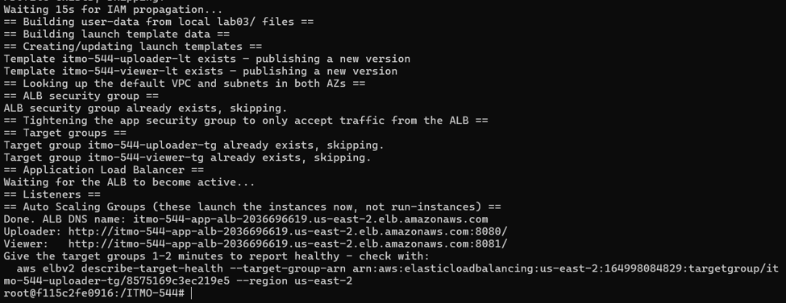
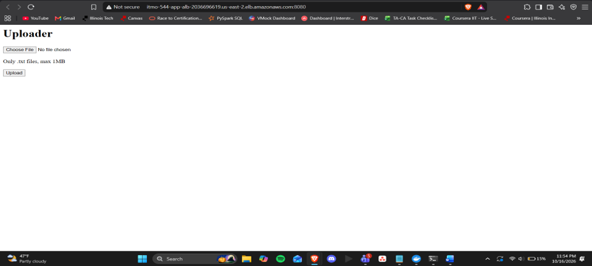
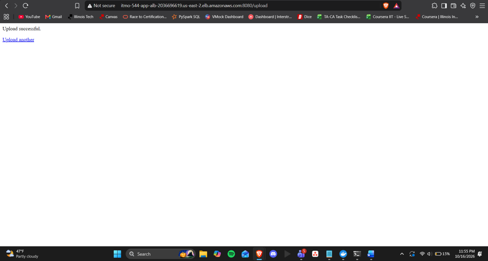
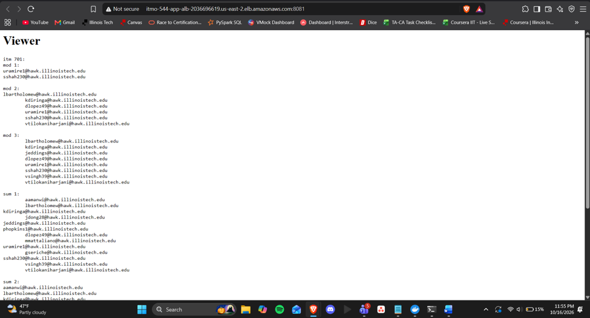
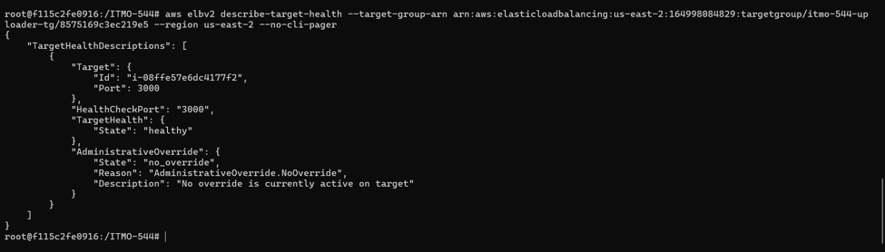
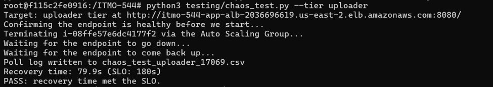
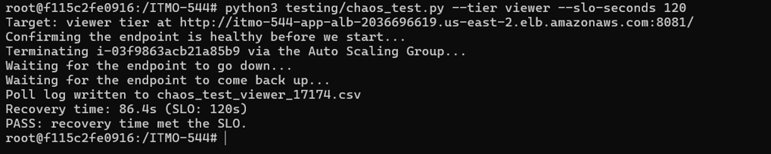
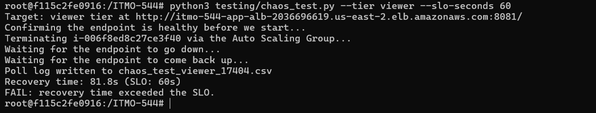
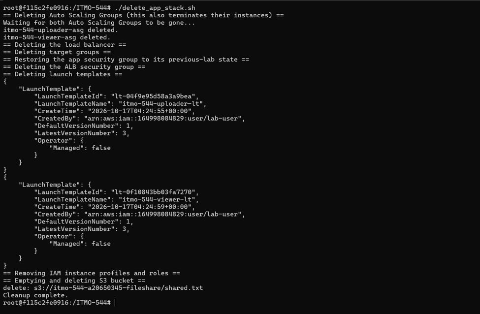

# Lab 04: Multi-AZ Resilience: ALB, Auto Scaling Groups, and Recovery-Time SLOs  
# Name: Vishnu Upadhya  

---
1.  Screenshot of create_app_stack.sh completing, showing both http://\<alb-dns\>:port/ URLs.

2.  Screenshot of both apps working through the ALB (uploader upload confirmation, viewer showing content).

Uploader:

Viewer:

3.  Screenshot of aws elbv2 describe-target-health showing both target groups healthy.

4.  The CSV poll log and console output from a chaos_test.py run that passed its SLO, for at least one tier.**

5.  The CSV poll log and console output from a run that failed a tightened SLO.**

6.  One paragraph explaining, using your own recovery-time numbers, what dominates the recovery window (health-check timing vs. boot/ npm install time vs. something else).

The uploader took 79.9 seconds to recover my 3 runs and the viewer took 86.4 and 81.8 seconds (very close, although the SLOs were 180, 120, and 60 seconds). This consistency suggests a fixed cost, which is the cost of replacing instance boot. The new instance has to run dnf update, install Node, run npm install, and start the service, which took about 59 seconds. The target group should then receive two healthy checks 10 seconds apart, thus giving them approximately 20 seconds of healthy checks. The boot and npm install time becomes the benchmark of the recovery window, which is why my 60 second SLO failed at 81.8 seconds.

7.  One paragraph explaining what changed in create_app_stack.sh / delete_app_stack.sh between the previous lab and this one — specifically, what replaced the old run-instances call and why.

The direct run-instances calls in create_app_stack.sh were removed and the instances ID files and the table of public IPs were removed as well. This lab measures self healing that occurs when an ASG with a desired capacity of 1 and the ELB health check type replaces a failed instance automatically. run-instances was replaced because it starts a machine once and never watches it. The script also creates an ALB security group and restricts the app security group to only accept traffic from the ALB with a port restriction, and saves the new resource IDs to the stack_outputs.env. In delete_app_stack.sh instances are no longer being removed based on their ID. These are the ASGs, load balancer, target groups and ALB security group that are deleted first, the original rule for the app security group is restored, and then the unchanged IAM and S3 cleanup comes next.

8.  Screenshot of delete_app_stack.sh completing with no errors.

