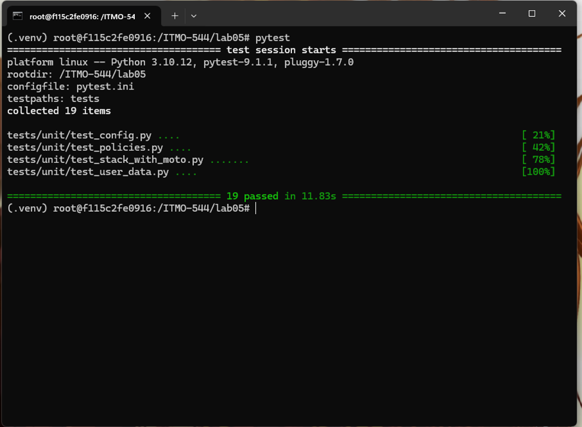
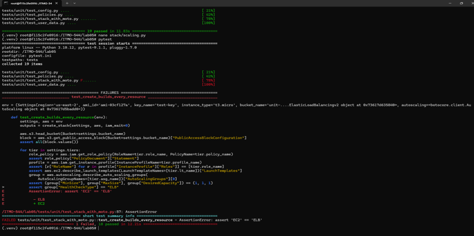
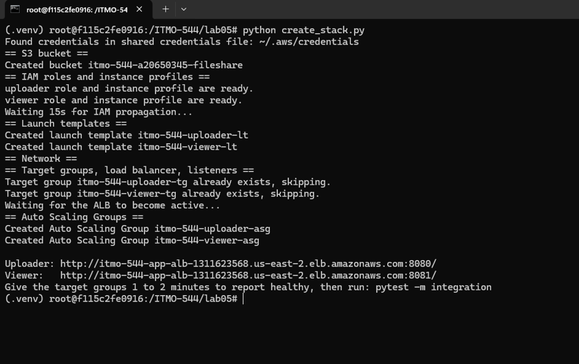
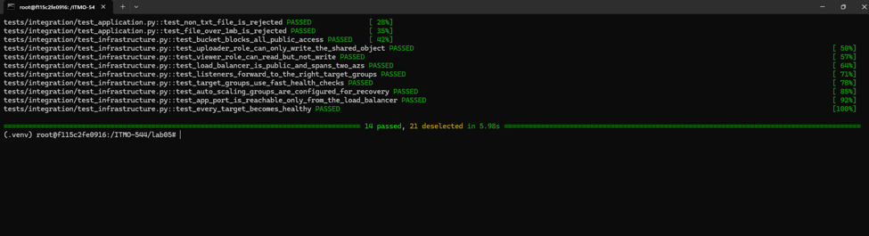
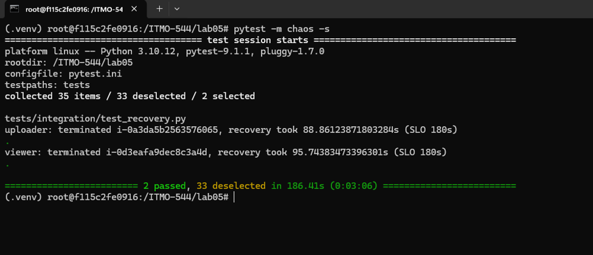

# Lab 05: Infrastructure as Python: From AWS CLI and Bash to boto3 and pytest  
# Name: Vishnu Upadhya  

---
1.  Output of ls -a lab05 (or a screenshot) showing the layout from Part 0 and section 4.

2.  Screenshot of pytest showing 19 passed.

3. Screenshot of one "break it on purpose" experiment: the changed line and the failing test message.

4.  Screenshot of python create_stack.py completing, with both URLs.

  
**Doesn’t allow upload of any other format. So I couldn’t upload any other file.**

5.  Screenshot of pytest -m integration -v with all 14 tests passing.

6.  Output of pytest -m chaos -s for both tiers, and the same run failing after you tightened the SLO.

7.  Screenshot of python delete_stack.py completing, and a second run completing with no errors.

8. One paragraph on what moto proved, what it could not, and which tests cover the gap.  
Moto has demonstrated the code's correctness by simulating AWS. It simulated the execution of the 19 unit tests with the real create_stack and delete_stack in memory, and it verified that the API calls are valid and correctly ordered. It also demonstrated that each resource is always set as desired, creating a copy twice does not create a second copy and deleting twice causes no errors. Because Moto doesn't model IAM propagation, and doesn't support real instances, it couldn't prove that AWS accepts those parameters or that the instances boot or that IAM policies allow and deny what is intended. The integration tests fill that void, testing what each role is allowed to do and confirm the instance actually booted and passed health checks.   

9. One paragraph comparing ignore_errors("EntityAlreadyExists") with 2>/dev/null || true.      
ignore_errors("EntityAlreadyExists") only catches the single error it expects (that the role or instance profile already exists), and re-raises all other errors. 2>/dev/null || true, on the other hand, hides all possible failures, such as typos, missing permissions, wrong names and network problems, and the script continues as if nothing ever happened.

10. Your answer to Challenge 5.  
The bash version of the bucket check was shorter, because it used a single head-bucket ... 2>/dev/null for the decision "skip/capture" for the check, while the Python version required a try/except block containing the code for the check result. These extra lines enable the code to only create the bucket when it hits the 404, and to break on 403, which means that the name is already used by another account, to avoid the confusing create-bucket failure.