# Lab 06: Weather Advisor in the Cloud: Two Tiers, a Free AI Model and a PostgreSQL Database  
# Name: Vishnu Upadhya  

---
1.  Output of ls -R lab06 | head -40, showing the layout from Part 0.

2. Output of the NWS calls from Part A and one sentence on why two upstream calls are needed

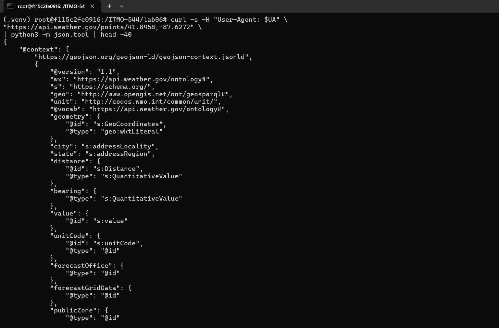

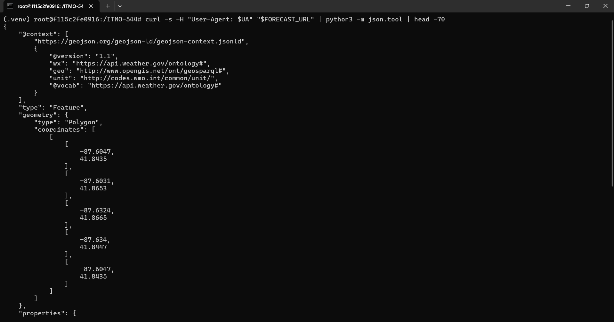

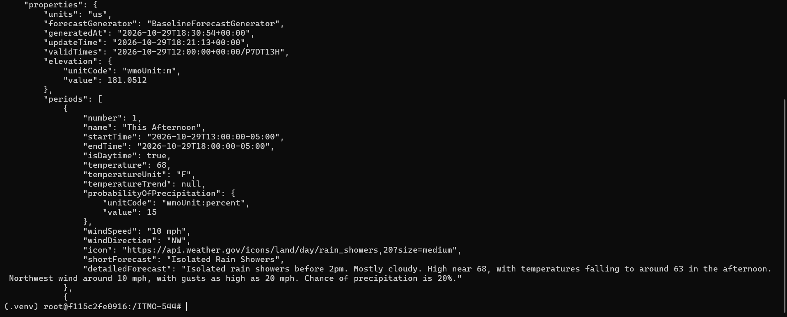

First, the zip code needs to be converted to latitude and longitude by the zip lookup service and that latitude and longitude needs to be passed as a parameter to the NWS points call and the NWS forecast call.

3. Output of create_database, and the Step 4 output showing retention 0, not public, single-AZ, and empty snapshot and automated backup lists

Output of `python3 create_database.py`:

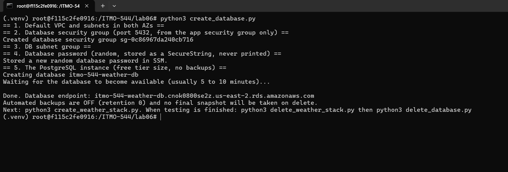

Step 4 output:

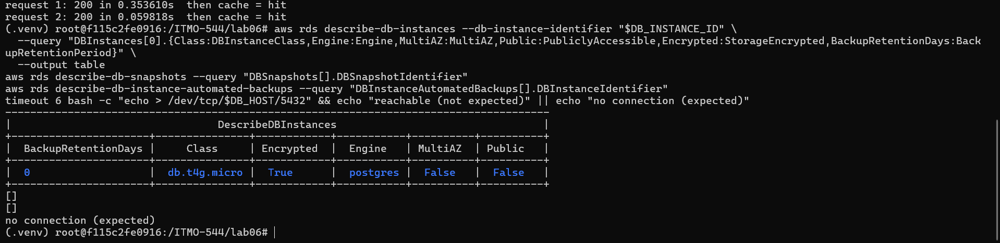

The table shows BackupRetentionDays 0, Public False, MultiAZ False, Encrypted True and class db.t4g.micro. Both print describe-db-snapshots, describe-db-instance-automated-backups returned [] and the connection test printed no connection. They demonstrate that there is no snapshot or backup storage, and that this database is not accessible from outside the VPC.  

Deployment output (Part G): create_weather_stack.py and the weather service

Output of `python3 create_weather_stack.py`, sections 1 to 7 and the two URLs:

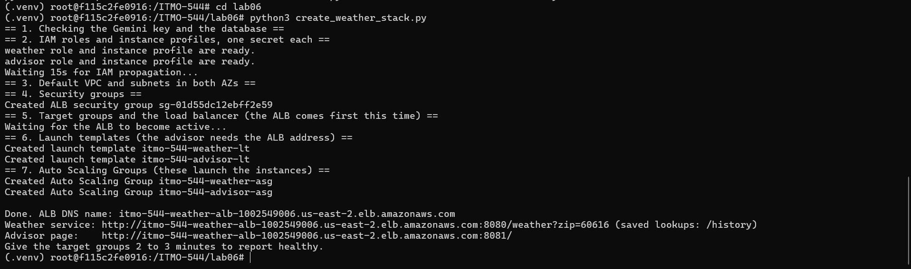

The weather service answering through the load balancer:

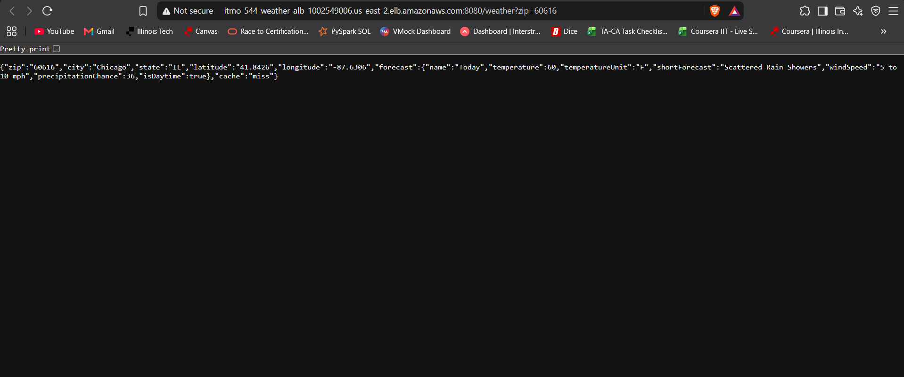

4. Screenshot of the advisor page showing a suggestion for a zip code, and the JSON from /advice?zip=... for the same zip

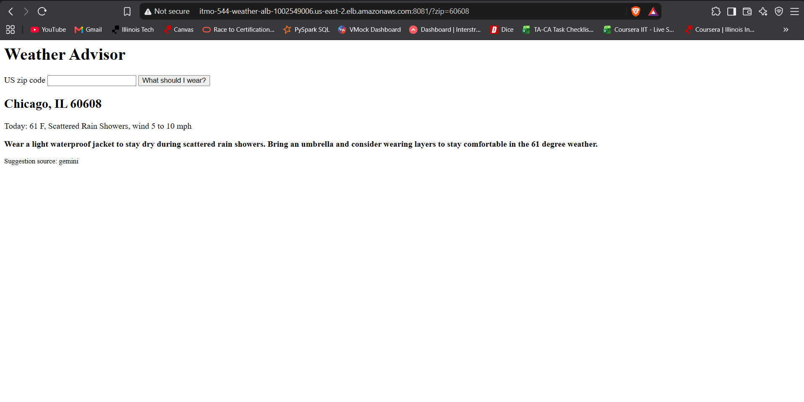

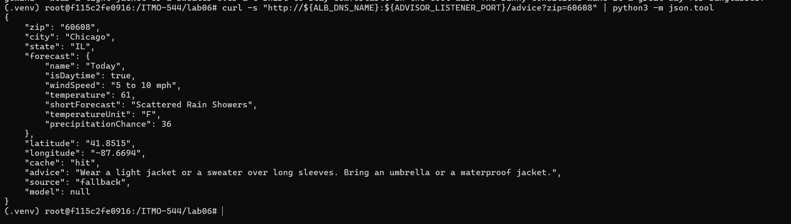

5. Output of app_smoke_test.py with all nine checks passing

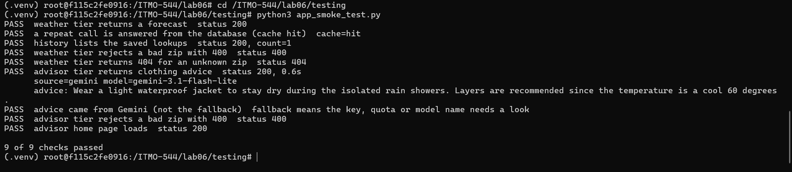

6. Step 1: a few lines of the weather journal, with a sentence explaining one weather_success line

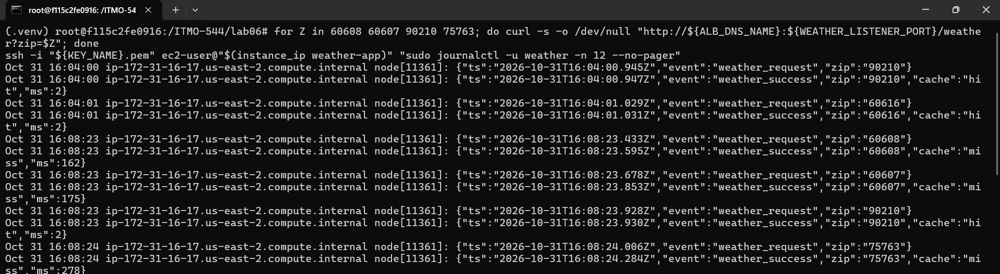

The result is stored in each line of weather_success, which is a JSON containing the zip code as well as a hit flag (either miss or hit) and the elapsed time in milliseconds. The line {"event":"weather_success","zip":"60608","cache":"miss","ms":162} indicates that the zip was not in the cache, so the service looked it up (NWS points), looked up the NWS forecast, saved the result and answered in 162 ms. The miss lines took 162 to 278 ms, while the hit lines (for example "zip":"90210","cache":"hit","ms":2) took 2 ms.  

7. Step 2: the /history output and the psql query output

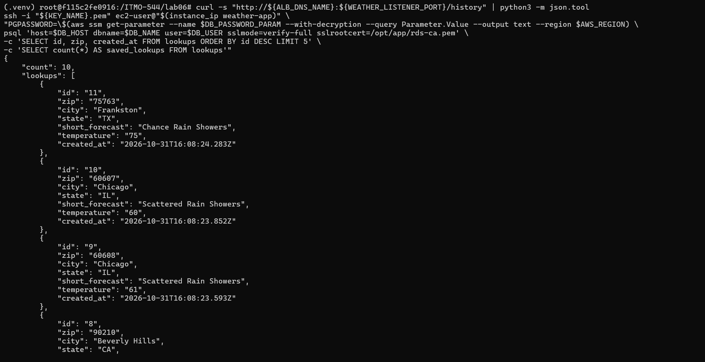

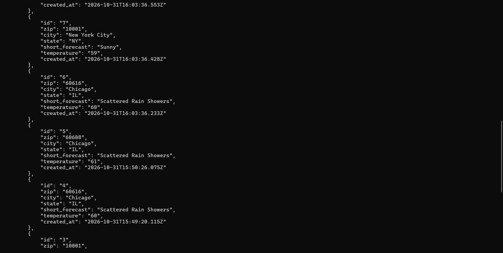

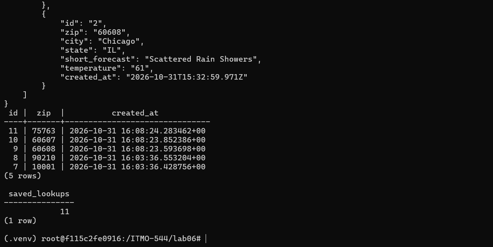

The /history output prints the last 10 saved lookups and psql shows that there are 11 rows (saved_lookups = 11). There are fewer rows than requests, because a row is created from the database, and nothing is written to it. In this case, the 16:04:00 requests for 90210 and 60616 were hits on the table, thus no new rows were created for them.  

8. Step 3: the miss and hit timings, and the two sentences

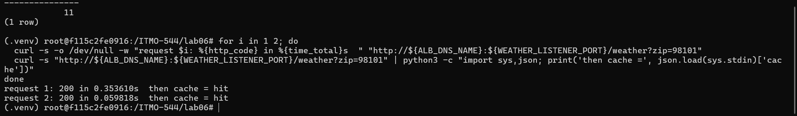

The first request to the zip 98101 took 0.35s, and the repeat took 0.06s. A short cache is more important if the service calls a rate-limited upstream, because if it makes such a call, it does not use up any of the upstream's rate allowance, and will continue to respond when the upstream response is slow. CACHE_SECONDS should be a relatively short period of time for weather, as forecasts are subject to change and a long cache would be for out-of-date conditions.

9. Step 5: the IAM simulator results for both roles and both secrets, and the sentence about the advisor tier

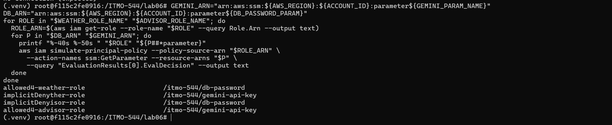

The weather role is allowed for the database password and implicitDeny for the Gemini key, and the advisor role is the reverse. If an attacker assumes control of the advisor tier, he acquires the gemini key, which enables him to abuse the quota and costs, but he does not acquire the password of the database, so the attacker can not log directly into the database.  

10. Step 6: the direct and through-the-ALB results, and the sentence about security group sources

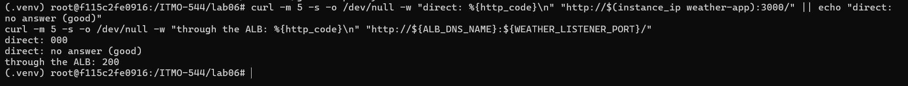

No answer (direct: 000) was received to the direct request to the instance on port 3000 and 200 was returned with the request made via the ALB. A rule that names another security group as its source lets in only resources that carry that group and follows the group's members as instances come and go, while a CIDR range admits any address in the range.

11. Step 7: the output while the database was cut off, the db_error log line, and the sentence about the 30 second pause

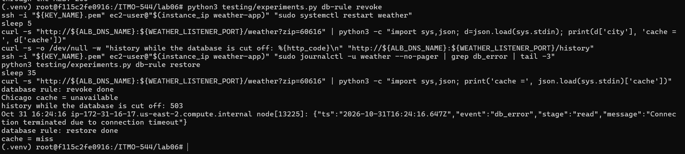

The database rule was removed, and the forecast returned (Chicago cache = unavailable), /history returned 503, and the journal recorded db_error ... Connection terminated due to connection timeout, which would not result in a database failure being a weather outage. Once the rule was restored the next request returned cache = miss, as the database now worked and the lookup was fetched and stored (it was not stored when the database was offline). This is 30 second pause because if this was removed then every request would have to wait out the 3 second connection timeout in case the database was down and all answers to a weather query would be slow.  

12. Step 8: the fallback answers, the gemini_error journal lines, and the sentence about the weakness of silent fallback

The key overwritten and the three fallback answers:

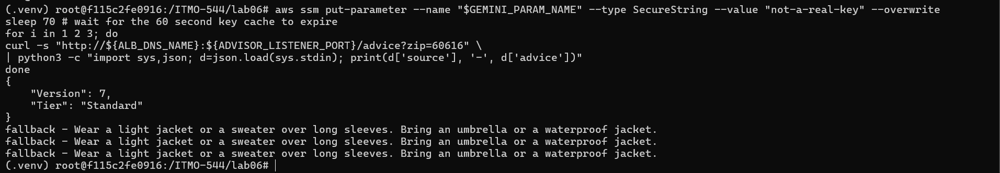

The gemini_error journal lines:

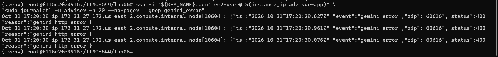

The key restored and the smoke test passing again:

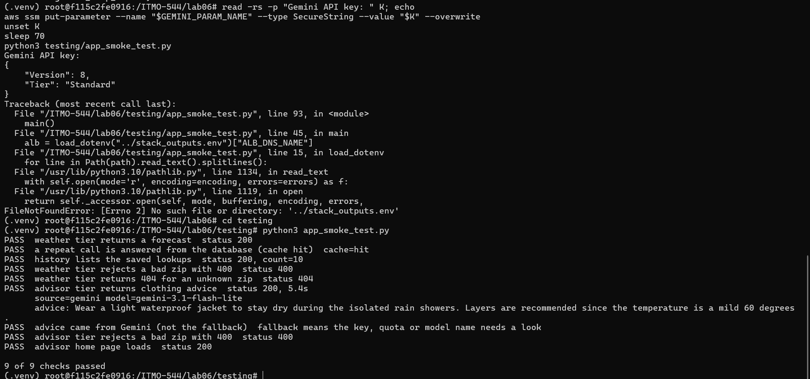

All three responses contained source fallback after the key was overwritten and the key cache timed out, and no request responded with an error. What is shown for the journal lines is status:400, meaning Google is rejecting the invalid key. The downside is that the user never sees an error so if a user accesses a broken key or runs up against a quota, he or she may not realize there is a problem until there's a log line indicating otherwise, but that log line isn't seen by anyone.  

13. Step 9: the recovery time measured, what the advisor returned during the outage, and the sentence about where state should live

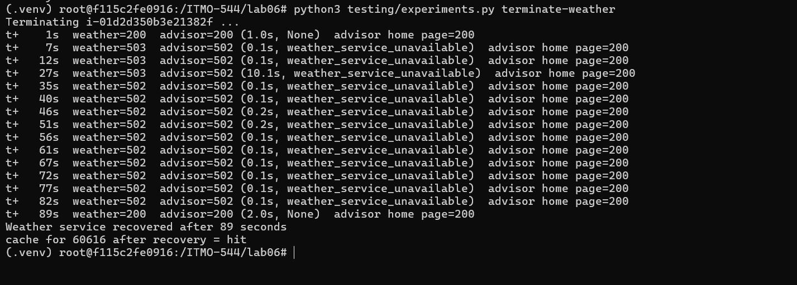

After 89 seconds, the weather service recovered. The advisor didn't hang during this outage, it answered 502 weather_service_unavailable quickly and its homepage remained 200. State should live in a managed service such as the database and not on the instance: the replacement instance answered cache = hit for zip 60616 using data saved by the old instance, which was no longer running.  

14. One paragraph on why the secrets are in SSM and each is read by one role, instead of in .env or the user-data

The key for the Gemini service and the password for the database are each stored within SecureString format in SSM Parameter Store, which means they're duplicated to locations that are difficult to control when the secret is stored in .env or within the user-data. The user-data is available in the instance metadata and in the EC2 console, the launch template stores a copy of it, .env is commit-able to Git, or it can be included in a screenshot or left in shell history. In SSM the value is encrypted at rest, retrieved only during runtime and each read action is an authenticated, loggable action. Only one role can access each secret. The weather role could use ssm:GetParameter to access the database password, and the advisor role could use ssm:GetParameter to access the Gemini key. The IAM simulator used in Step 5 allowed each role to use its secret, but denied access to the other roles' secrets, meaning that the takeover of one tier reveals only the secret that a given tier is already using. The database password is also created using secrets.token_hex and passed to SSM and to the database create call. The Gemini key is also entered by means of a hidden prompt, which means that neither of these values is written to a file or printed.  

15. One paragraph on turning backups off: what it saved, what it cost, and when it would never be done

The deletion of the backup and snapshot storage that RDS would normally retain when BackupRetentionPeriod is specified, and the deletion of the empty snapshot and automated backup lists in Step 4 and Step 10, respectively, made creating and deleting the database effortless and quick with no storage to be deleted later as the free allowance was reached and then exceeded. It lost the ability to recover anything. No point-in-time restore, no snapshot to roll back to, no copy of the data if the instance has been deleted by accident or corrupted. This is acceptable only because the service has a cache of public forecasts in the table from which it can be rebuilt from the upstream APIs. A database with real, irreplaceable or regulated data (e.g., customer data, orders, health data and such) and any production system should never be turned off, should have automated backups with a retention period, should be backed up with a final snapshot on deletion, and should preferably be backed up with Multi-AZ and deletion protection.  

16. One paragraph on what data was sent to Gemini and why the free tier makes that matter

The advisor sends Gemini the zip code, the city and the state and the forecast fields, which include the period name, the temperature, the short forecast and the wind speed for that zip code. The advisor also sends a fixed system prompt and the API key in the request header. All of this is weather information tied to a place and not to a person. No user name, no account and no other personal detail is included. This matters on the tier because under the terms, for unpaid Gemini API use the submitted content can be used by the provider to improve its products and can be reviewed by people. So anything sent should be treated as no private. The free tier also has a quota. So a public page that forwards every request can exhaust that quota. For that reason the prompt was kept to the fields needed and anything personal would have to be left out.

17. Answers to the Section 15.1 review questions

#### Secret storage:
Along with SSM, a secret may be exposed via shell history, via process list, via logs and error messages where settings and environment variables are printed out, via screenshots, and via Git where .env file or a script with the value is committed. Both user-data and launch templates can reveal a value since they both can be accessed from the console and the instance metadata. This lab prevents that by getting the Gemini key via a hidden prompt, creating the password with `secrets.token_hex`, passing it only to SSM and create, and adding .env and outputs file to .gitignore.  

#### Least privilege: 
If both roles had `ssm:*` permissions on `*`, a takeover of either role could retrieve both secrets, read all other parameters in the account, and modify or delete any parameters, for instance the Gemini key or the database password. The advisor role, being exposed to the public page and an external AI service, will directly provide access to the database login. With only one parameter required by each tier, the impact of each tier is reduced to the one secret required.  

#### Network exposure:
ALB is accessible to the internet since it is the sole public gateway that must be accessed by users, and it simply passes HTTP via the two listening ports. The instance receives port 3000 only from ALB security group while the database receives port 5432 only from the app security group and does not have a public IP address; hence, the only means of accessing them is through a component which is within control of the lab. Lessening the exposure to one hardened gateway limits the attack surface. This was evident in step 6 and database connection test.

#### Shared security group:
Both tiers have the same app security group, which is okay by the database rule; therefore, the advisor level may open the database on port 5432 despite the fact that it does not require it to. It does not contain the password for the database (because the IAM policy does not allow it), but a compromised password or an unprotected database would be accessible from the advisor level. The solution to the problem would be to make a separate security group for each tier.  

#### Database login:
Logging in as the master user who is allowed to create and drop tables and has read access to everything and also manage other users gives the app the ability to perform anything, in case of an SQL vulnerability or even a breach of password. There ought to be an application user rather than having it log in as the master user. As far as the weather service is concerned, it just retrieves data and saves lookups. So all it requires is CONNECT, USAGE, SELECT, and INSERT on lookups.  

#### Encryption:
The storage encryption happens when at rest, while the connection makes use of TLS with validation using the RDS CA bundle. With the TLS encryption that lacks the validation, the data traffic is always encrypted; however, it does not matter what certificate it is because a hacker lying on the traffic or responding to the address of the database will just issue his certificate and be able to read or alter the data traffic, including the password.  

#### SQL injection:
The query uses placeholders: `'INSERT INTO lookups (zip, payload) VALUES ($1, $2)', [zip, JSON.stringify(payload)]`. If the SQL were built by joining strings, for example `'... VALUES (' + zip + ...'`, a zip such as `1'); DROP TABLE lookups; --` would be run as SQL, which could delete or change data or leak rows. With placeholders the value is always sent as data and never parsed as SQL. The zip format check that returns 400 adds a second layer.

#### Backups:
In case of actual data, retention of 0 and no snapshots would imply that in case of any error, the actual data would be lost and there would be no possibility of restoring at any point in time. The actual database should have auto backup with retention period (at least 7 days), final snapshot at time of deletion, deletion protection, Multi-AZ and restore test.  

#### Data lifecycle:
In the context of an actual organization, the data owner is the one who determines, based on the policy governing the data. The owning business or department for the records, the legal compliance groups, and security management approval. It should be noted that it is not acceptable for the engineer to delete data based on his or her own judgment, and it needs to happen based on the documented retention policy and change approval.

#### Untrusted output:
If the page printed raw model output, an attacker could get the model to return markup such as a script tag, for example by manipulating text that reaches the prompt. The browser of every visitor would then run it, allowing the attacker to steal cookies or tokens, redirect visitors to other sites, show fake forms or change the page. Escaping the text with `escapeHtml` makes the browser display it as plain text.

#### Data sent to a third party:
Prior to actual users, the account should be switched into either a paid Gemini account or a school-owned Gemini account which specifies that the content is not going to be used for training or improving the model. This switch would involve a privacy policy and approval by the school's data office, an assurance that the prompt has just the zip code and forecast columns and never any user ID, and a determination of which region to use and of what to log.  

#### Abuse and cost:
Any user can keep calling the public /advice API endpoint in a loop and exhaust the free-tier limit, so actual users will have to suffer from receiving just the fallback responses (and incur charges if using a paid tier account). The following controls need to be applied to prevent that: rate limiting by client IP at the application layer or at the ALB, rate based AWS WAF rule, auth or API key for the advisor API, caching by zip code advice.    

#### Availability:
The labels source: fallback and cache: unavailable matter because without them a degraded answer looks like a normal one. Step 8 showed that a broken key produced valid-looking answers with no error, so the failure could go unnoticed. The labels let users and clients know the answer is reduced, allow monitoring to count and alert on fallback and unavailable responses, and allow tests to assert that the system degraded in the intended way. |

18. Output of the Step 10 verification commands showing no database instance, snapshot, automated backup, load balancer or lab role remains

Output of `python3 delete_weather_stack.py`:

Output of `python3 delete_database.py`:

Output of `python3 testing/experiments.py gemini delete`:

The nine verification commands, all returning an empty list:

The lists show that no database instance, snapshot, automated backup, DB subnet group, load balancer, Auto Scaling group, launch template, lab role or SSM parameter remains.

---

# 16.2. Graduate Students Only (ITMO 544): Python Checklist

## Code  

submitted in GitHub.

## Tests (run with pytest)

Unit tests with moto, run with `pytest -m "not integration and not chaos"`, with no AWS credentials (33 passed, every test listed):

Integration tests (`pytest -m integration -v`, 10 passed) against the real stack. They cover healthy target groups, miss then hit, /history, 400 and 404, /advice, the smoke script, the IAM simulator for each role and secret, the instances reachable only through the ALB, the database port closed from this computer, and the database with no backups and not public:

Chaos tests (`pytest -m chaos -s`, 2 passed). One revokes the database rule and checks that the forecast still returns 200 with cache unavailable, and one terminates the weather instance and checks that the advisor answers 502 and not a hang, and that the weather service answers 200 again (here after 90.04s, with the slowest advisor call during the outage at 10.1s):

## Short answers

### What moto could not prove, and which integration test covers each gap

Moto replaces the AWS API with an in-memory copy so Moto can show that the code sends the calls and parameters but Moto cannot show that the real services behave as intended.

Moto accepted `BackupRetentionPeriod=0`. The empty snapshot lists, but Moto cannot show that a real RDS instance keeps no automated backup or snapshot which the test `test_database_has_no_backups_and_no_public_address` and the empty lists in Step 4 and Step 10 check against real AWS.

Moto stores security group rules but does not enforce them so Moto cannot prove network reachability. The test `test_app_instances_are_reachable_only_through_the_alb` and the test `test_database_port_is_not_reachable_from_this_computer` try connections and Step 6 showed direct: 000 against 200 through the ALB.

Moto has no PostgreSQL server so Moto cannot prove TLS with certificate verification or that the app can read and write the database. The tests `test_weather_twice_returns_miss_then_hit` `test_history_lists_the_lookup` and the psql query with `sslmode=verify-full` in Step 2 cover this through the service.

Moto does not evaluate IAM policies the way AWS does so the test `test_each_role_can_read_only_its_own_secret` uses `simulate_principal_policy` against the roles.

Moto does not run the user-data. Start the Node apps so the tests `test_both_target_groups_are_healthy` `test_advice_is_returned` and `test_smoke_script_passes` prove that the instances boot and answer.

### Python and bash versions of the same step

Creating the database and waiting for it was easier to get right in Python. The specific ClientError codes handled by `ignore_errors` made it simple to be idempotent to tolerate resources that already exist or are already gone and to fail loudly on any error. In contrast the bash version depends on text output, `--query` strings and `set -e` where a hidden `2>/dev/null` once masked a failure in Lab04. Values like the generated password the group ids and the outputs file are variables and objects in Python so no secret needs to appear in a command line. The Python version was also much easier to test. Each step is a function that moto can run in a unit test with no AWS credentials, running it twice or after a delete. Bash was shorter for a one-time sequence of commands and easier to read at a glance, but that advantage disappears once the script needs retries, error handling and tests.