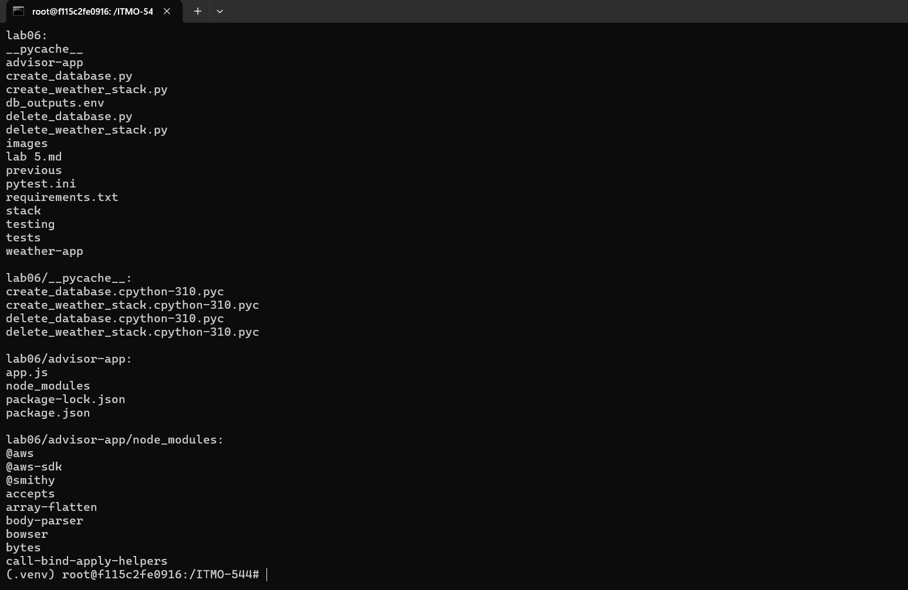
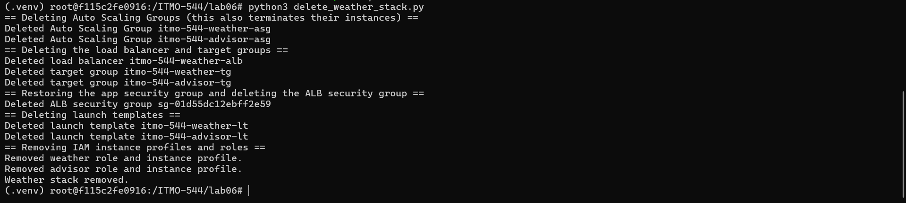
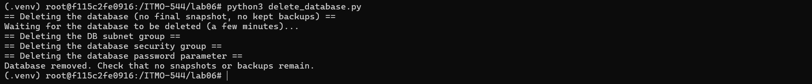
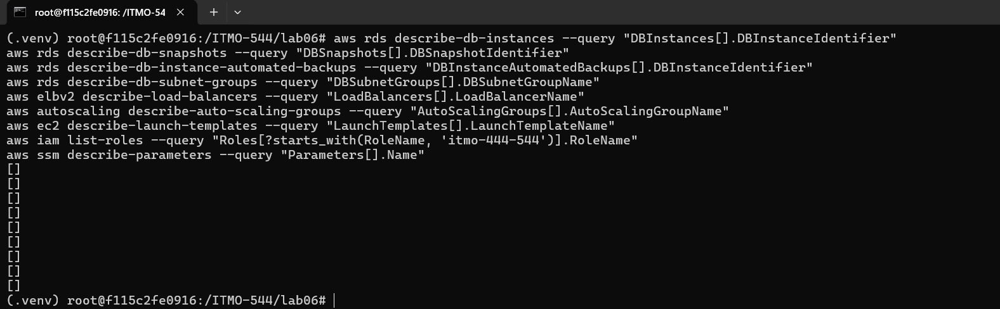
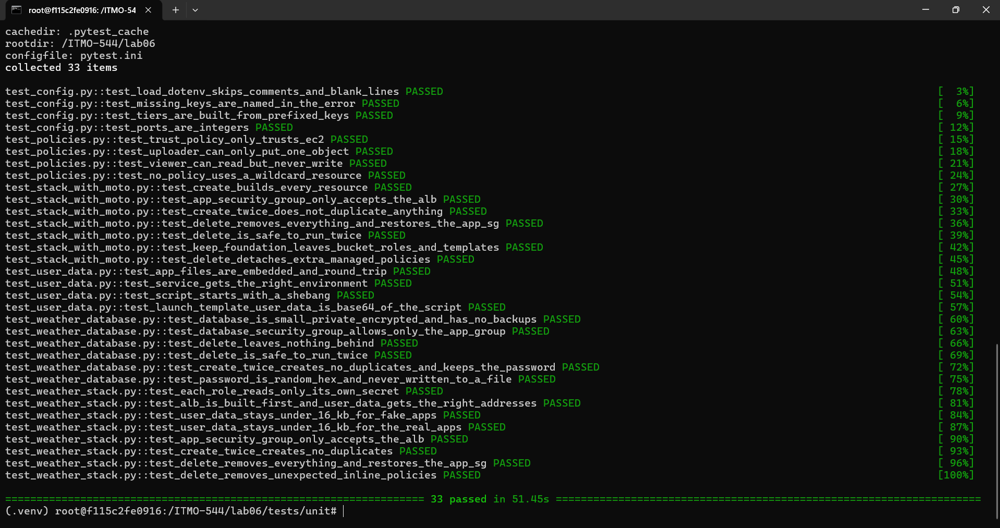
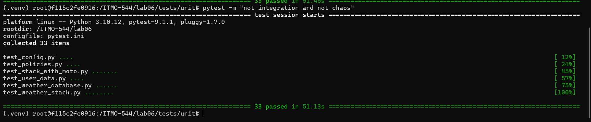
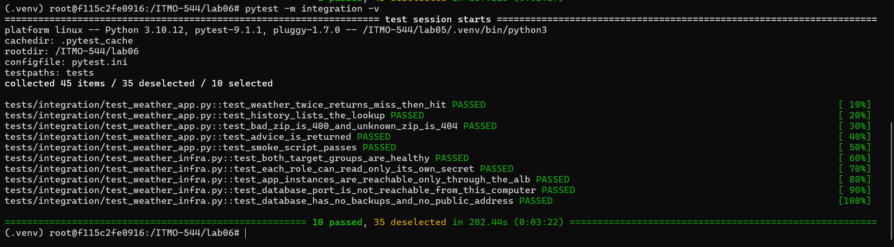
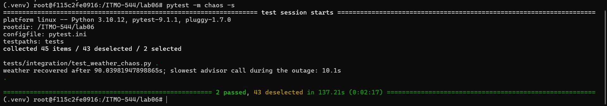

# Lab 06: Weather Advisor in the Cloud: Two Tiers, a Free AI Model and a PostgreSQL Database  
# Name: Vishnu Upadhya  

---
1.  Output of ls -R lab06 | head -40, showing the layout from Part 0.

2. Output of the NWS calls from Part A and one sentence on why two upstream calls are needed

Two upstream calls are needed because the National Weather Service accepts coordinates and not zip codes, so the zip code must first be converted to latitude and longitude by the zip lookup service, and the coordinates are then used for the NWS points call and the NWS forecast call.

3. Output of create_database, and the Step 4 output showing retention 0, not public, single-AZ, and empty snapshot and automated backup lists

Output of `python3 create_database.py`:

Step 4 output:

The table shows BackupRetentionDays 0, Public False, MultiAZ False, Encrypted True and class db.t4g.micro. Both describe-db-snapshots and describe-db-instance-automated-backups returned [], and the connection test printed no connection (expected). Together they show that no backup or snapshot storage is used, and that the database cannot be reached from outside the VPC.

## Deployment output (Part G): create_weather_stack.py and the weather service

Output of `python3 create_weather_stack.py`, sections 1 to 7 and the two URLs:

The weather service answering through the load balancer:

4. Screenshot of the advisor page showing a suggestion for a zip code, and the JSON from /advice?zip=... for the same zip

5. Output of app_smoke_test.py with all nine checks passing

6. Step 1: a few lines of the weather journal, with a sentence explaining one weather_success line

Each weather_success line records one finished request as JSON: the zip, whether the answer came from the database cache (hit) or from the upstream APIs (miss), and the time in milliseconds. The line {"event":"weather_success","zip":"60608","cache":"miss","ms":162} means the zip was not cached, so the service called the zip lookup, NWS points and NWS forecast, saved the result and answered in 162 ms. The miss lines took 162 to 278 ms, while the hit lines (for example "zip":"90210","cache":"hit","ms":2) took 2 ms.

7. Step 2: the /history output and the psql query output

The /history output lists the ten most recent saved lookups, and the psql query confirms the table holds 11 rows (saved_lookups = 11). There are fewer rows than requests because a cache hit is answered from the database and nothing new is written. For example, the 16:04:00 requests for 90210 and 60616 were hits, so no new rows were added for them.

8. Step 3: the miss and hit timings, and the two sentences

The first request for zip 98101 took 0.35 s (a miss: two upstream calls plus a database write), and the repeat took 0.06 s (a hit: no upstream calls). A short cache matters more for a service that calls a rate-limited upstream, because each hit makes no upstream call and so uses none of the allowance, and it keeps the service answering when the upstream is slow. CACHE_SECONDS should not be very long for weather, because forecasts change and a long cache would serve outdated conditions.

9. Step 5: the IAM simulator results for both roles and both secrets, and the sentence about the advisor tier

The weather role is allowed for the database password and implicitDeny for the Gemini key, and the advisor role is the reverse. An attacker who takes over the advisor tier gets the Gemini key, which allows quota and cost abuse, but not the database password, so there is no direct database login.

10. Step 6: the direct and through-the-ALB results, and the sentence about security group sources

The direct request to the instance on port 3000 got no answer (direct: 000), and the request through the ALB returned 200. A rule that names another security group as its source lets in only resources that carry that group and follows the group's members as instances come and go, while a CIDR range admits any address in the range.

11. Step 7: the output while the database was cut off, the db_error log line, and the sentence about the 30 second pause

With the database rule revoked, the forecast still returned (Chicago cache = unavailable), /history returned 503, and the journal recorded db_error ... Connection terminated due to connection timeout, so a database failure did not become a weather outage. After the rule was restored, the next request returned cache = miss, meaning the database worked again and the lookup was fetched and saved (it had not been saved while the database was cut off). The 30 second pause exists because, without it, every request would wait out the 3 second connection timeout while the database is down, making every weather answer slow.

12. Step 8: the fallback answers, the gemini_error journal lines, and the sentence about the weakness of silent fallback

The key overwritten and the three fallback answers:

The gemini_error journal lines:

The key restored and the smoke test passing again:

After the key was overwritten and the key cache expired, all three answers came back with source fallback, and no request returned an error. The journal lines at 17:20:29 show "status":400, which is Google rejecting the invalid key. The weakness is that users never see an error, so a broken key or an exhausted quota can go unnoticed when the only evidence is a log line that nobody reads.

13. Step 9: the recovery time measured, what the advisor returned during the outage, and the sentence about where state should live

The weather service recovered after 89 seconds. During the outage the advisor answered 502 weather_service_unavailable quickly (mostly within 0.2 seconds, never more than about 10 seconds) instead of hanging, and its home page stayed 200. State should live in a managed service such as the database and not on the instance: the replacement instance answered cache = hit for zip 60616 using data saved by the old instance, which was no longer running.

14. One paragraph on why the secrets are in SSM and each is read by one role, instead of in .env or the user-data

The Gemini key and the database password are stored in SSM Parameter Store as SecureString values because a secret placed in .env or in the user-data is copied to places that are hard to control. The user-data is readable from the instance metadata and from the EC2 console, the launch template keeps a copy of it, and .env can be committed to Git, shown in a screenshot or left in shell history. In SSM the value is encrypted at rest, it is fetched only at run time, and every read is an authenticated, loggable call. Each secret is readable by exactly one role: the weather role can call ssm:GetParameter only on the database password, and the advisor role only on the Gemini key. The IAM simulator in Step 5 showed allowed for each role on its own secret and implicitDeny on the other's, so the takeover of one tier exposes only the secret that tier already needs. The database password is also generated with secrets.token_hex and sent only to SSM and to the database create call, and the Gemini key is entered through a hidden prompt, so neither value is written to a file or printed.

15. One paragraph on turning backups off: what it saved, what it cost, and when it would never be done

Setting BackupRetentionPeriod to 0 and deleting with no final snapshot saved the backup and snapshot storage that RDS would otherwise keep, which can be billed once it exceeds the free allowance, and it also made the database quick to create and to delete with nothing left behind to remove, as the empty snapshot and automated backup lists in Step 4 and Step 10 show. It cost the ability to recover anything: no point-in-time restore, no snapshot to roll back to, and no copy of the data if the instance is deleted or corrupted by mistake. This was acceptable only because the table holds a cache of public forecasts that the service can rebuild from the upstream APIs. Backups should never be turned off for a database that holds real, irreplaceable or regulated data such as customer records, orders or health data, or for any production system; those need automated backups with a retention period, a final snapshot on deletion, and ideally Multi-AZ and deletion protection.

16. One paragraph on what data was sent to Gemini and why the free tier makes that matter

The advisor sends Gemini only the zip code, the city and state, and the forecast fields (the period name, temperature, short forecast and wind speed) for that zip, together with a fixed system prompt and the API key in the request header. All of this is public weather information tied to a place and not to a person, and no user name, account or other personal detail is included. This matters on the free tier because, under the terms for unpaid Gemini API use, the submitted content can be used by the provider to improve its products and can be reviewed by people, so anything sent should be treated as no longer private. The free tier also has a small quota, so a public page that forwards every request can exhaust it. For that reason the prompt was kept to the minimum fields needed, and anything personal would have to be left out or a paid or school-owned account with suitable data terms would have to be used.

17. Answers to the Section 15.1 review questions

| Topic | Answer |
|---|---|
| Secret storage | Besides SSM, a secret can leak from shell history (a key typed into a command such as `aws ssm put-parameter --value ...`), from process lists (command-line arguments are visible to `ps`), from logs and error messages that print settings or environment variables, from screenshots, and from Git when .env or a script containing the value is committed. The user-data and the launch template can also expose a value, because both can be read from the console and the instance metadata. The lab avoids these by reading the Gemini key with a hidden prompt, generating the password with `secrets.token_hex`, sending it only to SSM and the create call, and keeping .env and the outputs file in .gitignore. |
| Least privilege | If both roles had `ssm:*` on `*`, a takeover of either tier could read both secrets, read every other parameter in the account, and overwrite or delete parameters, for example replacing the Gemini key or the database password. The advisor tier, which faces the public page and an outside AI service, would then lead straight to a database login. With one parameter per role, the damage from each tier is limited to the one secret it already needs. |
| Network exposure | The ALB is open to the internet because it is the single public entry point that users must reach, and it only forwards HTTP on the two listener ports. The instances accept port 3000 only from the ALB security group, and the database accepts port 5432 only from the app security group and has no public address, so the only way to reach them is through a component that the lab controls. Reducing what is exposed to one hardened front door reduces the attack surface. Step 6 and the database connection test showed this (direct: 000 and no connection). |
| Shared security group | Both tiers share one app security group, which the database rule allows, so an advisor instance can open a connection to the database on port 5432 although it does not need to. It does not hold the database password (the IAM policy denies it), but a stolen password or an unauthenticated database setting would be reachable from the advisor tier. The fix is to give each tier its own security group and to allow port 5432 on the database only from the weather group. |
| Database login | The app logs in as the master user, which can create and drop tables, read everything and manage other users, so a SQL flaw or a stolen password would give full control. A separate application user should be created instead. The weather service only looks up and saves lookups, so that user needs `CONNECT` on the database, `USAGE` on the schema, and `SELECT` and `INSERT` on the lookups table (plus the right to create the table once, or a separate migration step), and nothing else. |
| Encryption | Storage is encrypted at rest, and the connection uses TLS with certificate verification against the RDS CA bundle. TLS without verification encrypts the traffic but accepts any certificate, so an attacker who sits on the path or answers at the database address could present their own certificate and read or change the traffic, including the password. The certificate check proves that the server is really the RDS instance and not an impostor. |
| SQL injection | The query uses placeholders: `pool.query('INSERT INTO lookups (zip, payload) VALUES ($1, $2)', [zip, JSON.stringify(payload)])`. If the SQL were built by joining strings, for example `'... VALUES (' + zip + ...'`, a zip such as `1'); DROP TABLE lookups; --` would be run as SQL, which could delete or change data or leak rows. With placeholders the value is always sent as data and never parsed as SQL. The zip format check that returns 400 adds a second layer. |
| Backups | With real data, retention 0 and no snapshots would mean that an accidental delete, a bad update or a failed instance would lose the data permanently, with no point-in-time restore. A real database should have automated backups with a retention period (for example 7 days or more), a final snapshot on deletion, deletion protection, Multi-AZ, and regular restore tests. |
| Data lifecycle | In a real organization the data owner decides, together with the policies that apply to the data: the business or department that owns the records, the legal and compliance teams (retention periods, legal holds, privacy law), and security and management approval. An engineer should not delete data on their own judgement, and deletion should follow the written retention policy and a change approval, with a record of who approved it and when. |
| Untrusted output | If the page printed raw model output, an attacker could get the model to return markup such as a script tag, for example by manipulating text that reaches the prompt. The browser of every visitor would then run it (cross-site scripting), allowing the attacker to steal cookies or tokens, redirect visitors to other sites, show fake forms or change the page. Escaping the text with `escapeHtml` makes the browser display it as plain text. |
| Data sent to a third party | Before real users, the account would have to be changed to a paid or school-owned Gemini account whose terms say that content is not used to train or improve models and that define retention and review. The change would also include a privacy notice and approval from the school's data office, a review that the prompt still contains only the zip code and forecast fields and never user identifiers, and a decision about the region and about logging what is sent. |
| Abuse and cost | Anyone can call the public /advice endpoint in a loop and use up the free tier quota, so real users would get only the fallback answers (and, on a paid account, the bill would grow). Controls to add are rate limiting per client IP in the app or at the ALB, an AWS WAF rate-based rule, authentication or an API key for the advisor, caching of advice per zip, request size limits, and quota and billing alarms. |
| Availability | The labels source: fallback and cache: unavailable matter because without them a degraded answer looks like a normal one. Step 8 showed that a broken key produced valid-looking answers with no error, so the failure could go unnoticed. The labels let users and clients know the answer is reduced, allow monitoring to count and alert on fallback and unavailable responses, and allow tests to assert that the system degraded in the intended way. |

18. Output of the Step 10 verification commands showing no database instance, snapshot, automated backup, load balancer or lab role remains

Output of `python3 delete_weather_stack.py`:

Output of `python3 delete_database.py`:

Output of `python3 testing/experiments.py gemini delete`:

The nine verification commands, all returning an empty list:

The lists show that no database instance, snapshot, automated backup, DB subnet group, load balancer, Auto Scaling group, launch template, lab role or SSM parameter remains.

---

# 16.2. Graduate Students Only (ITMO 544): Python Checklist

## Code

The Python code is submitted as files, built on the Lab05 `stack/` package:

| Requirement | File |
|---|---|
| Database create and delete (security group and rule, DB subnet group, random password parameter, PostgreSQL instance, database outputs) | `create_database.py`, `delete_database.py`, `stack/database.py` |
| Weather stack create and delete (roles and profiles, one-secret policies, security groups, target groups, ALB and listeners, launch templates, Auto Scaling Groups) | `create_weather_stack.py`, `delete_weather_stack.py`, `stack/wstack.py` |
| Settings from .env, nothing hard-coded | `stack/wconfig.py` |
| AWS clients and account id | `stack/wclients.py` |
| Policy builders for one secret per role | `stack/wpolicies.py` |
| Hidden Gemini key prompt (`getpass`), stored as a SecureString | `testing/store_gemini_key.py` |
| Python smoke test (nine checks, including cache and history) | `testing/app_smoke_test.py` |
| Break and recovery experiments (Gemini key, database rule, terminate weather) | `testing/experiments.py` |

## Tests (run with pytest)

Unit tests with moto, run with `pytest -m "not integration and not chaos"`, with no AWS credentials (33 passed, every test listed):

Integration tests (`pytest -m integration -v`, 10 passed) against the real stack. They cover healthy target groups, miss then hit, /history, 400 and 404, /advice, the smoke script, the IAM simulator for each role and secret, the instances reachable only through the ALB, the database port closed from this computer, and the database with no backups and not public:

Chaos tests (`pytest -m chaos -s`, 2 passed). One revokes the database rule and checks that the forecast still returns 200 with cache unavailable, and one terminates the weather instance and checks that the advisor answers 502 and not a hang, and that the weather service answers 200 again (here after 90.04 s, with the slowest advisor call during the outage at 10.1 s):

## Short answers

### What moto could not prove, and which integration test covers each gap

Moto replaces the AWS API with an in-memory copy, so it can show that the code sends the right calls and parameters, but not that the real services behave as intended. It accepted `BackupRetentionPeriod=0` and the empty snapshot lists, but it cannot show that a real RDS instance keeps no automated backup or snapshot, which `test_database_has_no_backups_and_no_public_address` and the empty lists in Step 4 and Step 10 check against real AWS. It stores security group rules but does not enforce them, so it cannot prove real network reachability; `test_app_instances_are_reachable_only_through_the_alb` and `test_database_port_is_not_reachable_from_this_computer` try real connections, and Step 6 showed direct: 000 against 200 through the ALB. It has no real PostgreSQL server, so it cannot prove TLS with certificate verification or that the app can read and write the database; `test_weather_twice_returns_miss_then_hit`, `test_history_lists_the_lookup` and the psql query with `sslmode=verify-full` in Step 2 cover this through the real service. It does not evaluate IAM policies the way AWS does, so `test_each_role_can_read_only_its_own_secret` uses `simulate_principal_policy` against the real roles. It does not run the user-data or start the Node apps, so `test_both_target_groups_are_healthy`, `test_advice_is_returned` and `test_smoke_script_passes` prove that the instances boot and answer. Finally, it cannot show real timing or failure behavior, such as the cache and degraded answers when the database is cut off or the 89 to 90 second recovery after a terminated instance, which the two chaos tests measure.

### Python and bash versions of the same step

Creating the database and waiting for it was easier to get right in Python. The waiter and the specific ClientError codes handled by `ignore_errors` made it simple to be idempotent, to tolerate resources that already exist or are already gone, and to fail loudly on any other error, while the bash version depends on text output, `--query` strings and `set -e`, where a hidden `2>/dev/null` once masked a real failure in Lab04. Values such as the generated password, the group ids and the outputs file are plain variables and objects in Python, so no secret needs to appear in a command line. The Python version was also much easier to test: each step is a small function that moto can run in a unit test with no AWS credentials, and running it twice or after a delete can be asserted, whereas the bash script can only be tested by running it against a real account. Bash was shorter for a one-time sequence of commands and easier to read at a glance, but that advantage disappears once the script needs retries, error handling and tests.
