# Lab 07: Infrastructure as Code with Terraform: Rebuild the Weather Advisor    
# Name: Vishnu Upadhya  

---
1. Output of terraform version and aws sts get-caller-identity (hide the account number).

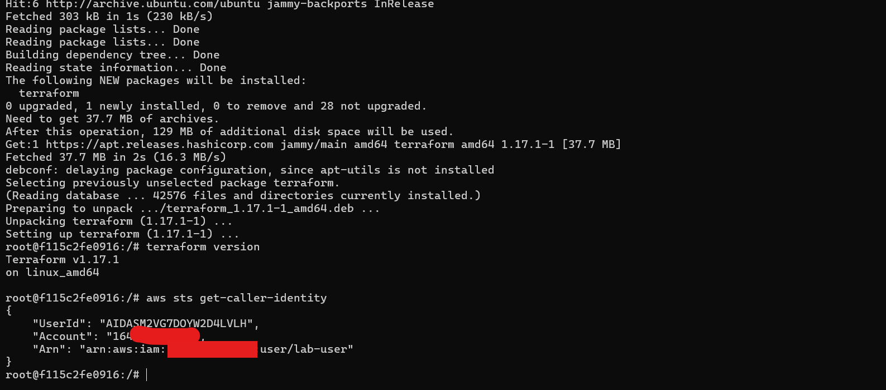

2. Part A: the plan before the first apply, the second apply showing No changes, the in-place update plan (~) and the replacement plan (-/+), with a sentence on why -/+ is the one to be careful about

The plan before the first apply:

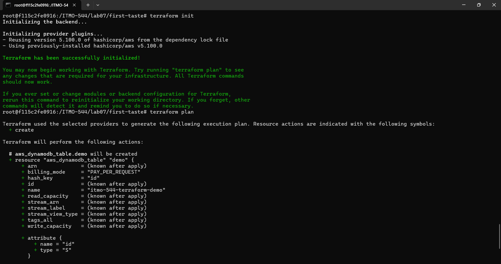

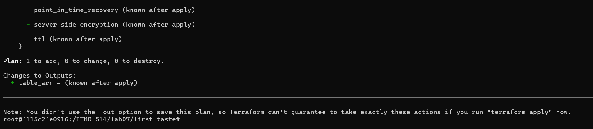

The apply, terraform state list, and the second apply showing No changes:

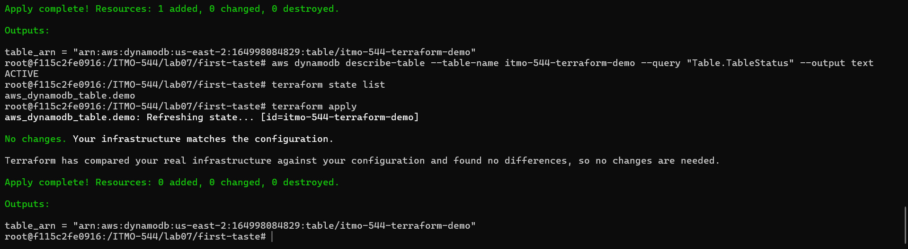

The in-place update plan:

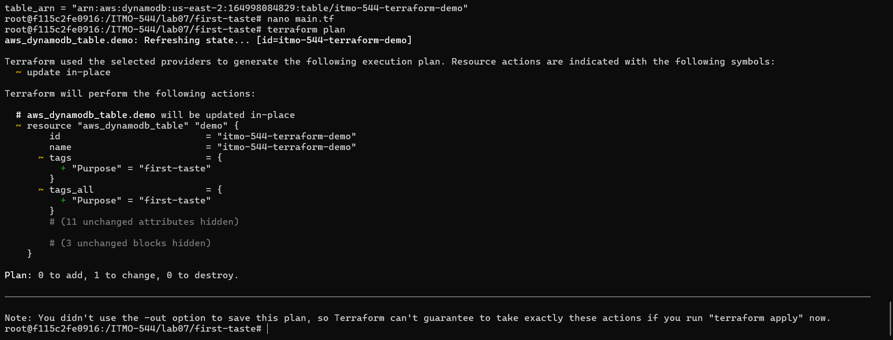

The replacement plan:

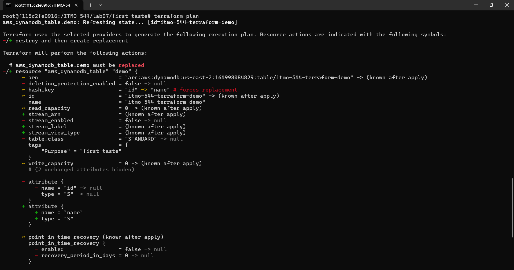

The first plan said Plan: 1 to add, 0 to change, 0 to destroy, and listed the table attributes as (known after apply). The second apply printed No changes, which is idempotence: the same configuration was applied twice and nothing was done the second time, without a single `if` being written. Adding the tags line produced a ~ update in place with + "Purpose" = "first-taste", and Plan: 0 to add, 1 to change, 0 to destroy. The -/+ plan is the one to be careful about because DynamoDB cannot change a table's key, so changing the hash_key makes Terraform destroy the table and create a new empty one, which deletes all of the data in it, and the plan is the only warning given before that happens.

3. Output of terraform fmt, terraform validate and the last lines of terraform plan showing the number of resources to add

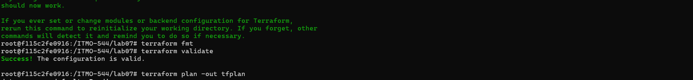

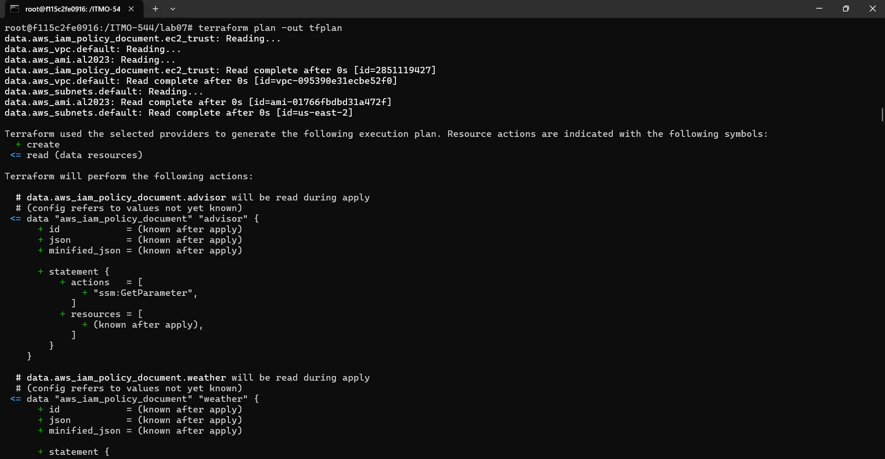

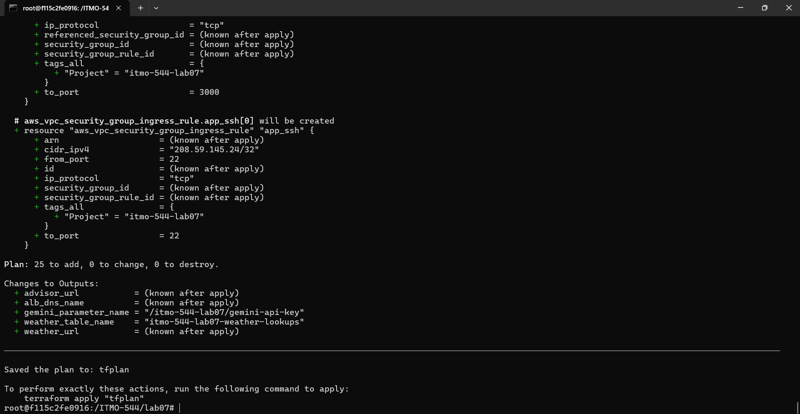

4. Output of app_smoke_test.py with all nine checks passing, and a screenshot of the advisor page

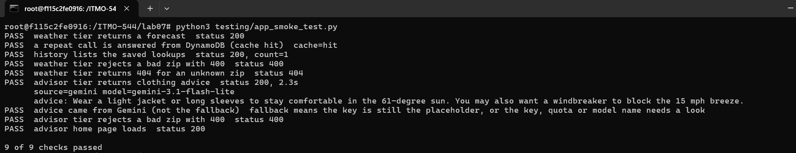

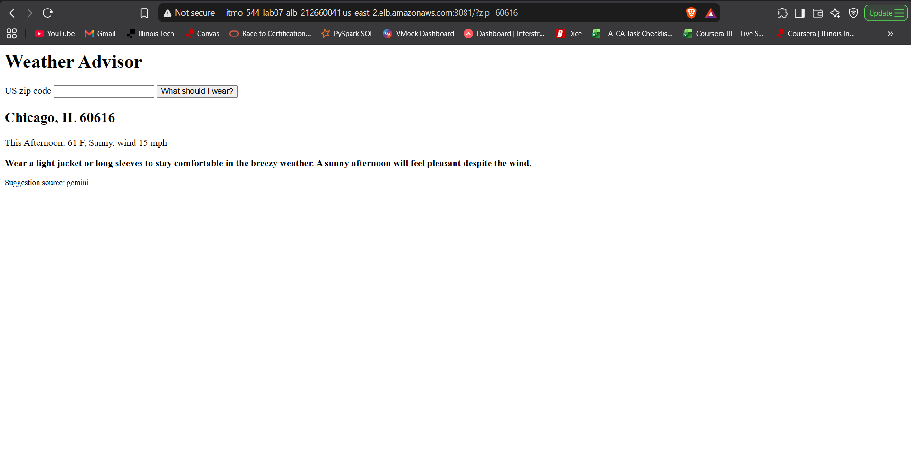

All nine checks passed: the weather tier returned a forecast, the repeat call was a cache hit answered from DynamoDB, /history listed the saved lookup, a bad zip gave 400, an unknown zip gave 404, the advisor returned advice from Gemini (source=gemini, model gemini-3.1-flash-lite, in 2.3 seconds), a bad zip on the advisor gave 400, and the advisor home page loaded. The advisor page for zip 60616 shows Chicago, IL, the forecast for this afternoon, the advice, and Suggestion source: gemini. The page was opened through the load balancer on port 8081, and the addresses for the smoke test came from terraform output, so no file had to be kept in sync.

5. Steps 1 to 3: the effort table with line counts, the terraform graph output with a sentence, and the No changes plan with a sentence comparing it to running the script twice

### Step 1. Count the effort

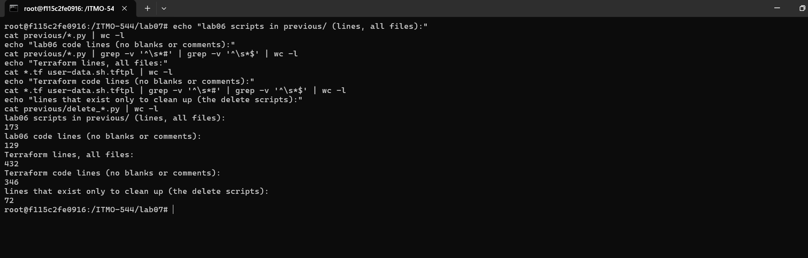

| | lab06 Python | lab07 Terraform |
|---|---|---|
| Lines to create the stack | 173-72 = 101 | 432 |
| Lines to delete the stack | 72 | 0 |
| Steps you had to order by hand | 7 | 0 |
| Helper functions you wrote | 7 | 0 |
| Retry or wait loops you wrote | 4 | 0 |

### Step 2. Prove the order Terraform worked out

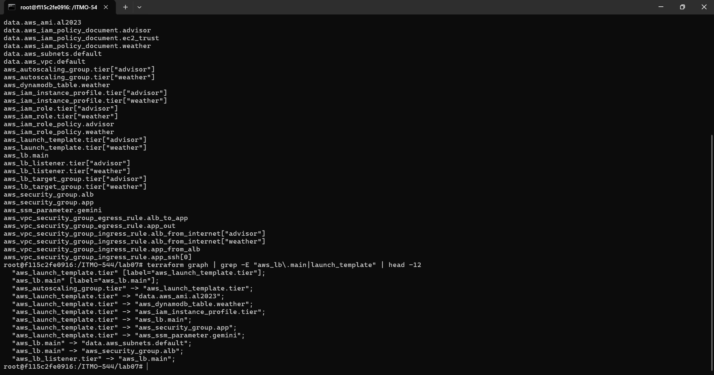

The graph shows the arrow "aws_launch_template.tier" -> "aws_lb.main": this means that the launch templates depend on the load balancer, along with "aws_lb_listener.tier" -> "aws_lb.main" and "aws_autoscaling_group.tier" -> "aws_launch_template.tier". Without the WEATHER_URL line in the compute.tf file, aws_lb.main would not be referenced in the advisor's launch template, which would cause Terraform to not create the load balancer first, and the advisor would not work since there would be no weather tier address.

### Step 3. Run apply again

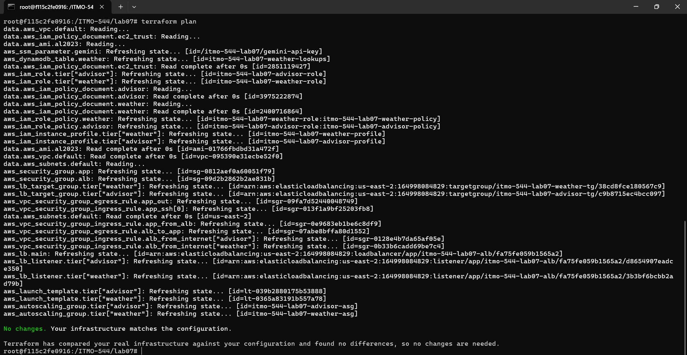

The plan states that there are "No changes. Your infrastructure is configured as you want.". The lab06 create script only prints for each name it finds "already exists, skipping", so it checks to see if a resource with that name exists. But it doesn't check to see if its settings are correct. Terraform plan compares all settings of all resources to the code and the state.

6. Steps 4 and 5: the plan for cache_seconds = 60, the instance refresh status and new CACHE_SECONDS=60 line, and the drift plans with a sentence about ensure_target_group

### Step 4. Change one setting and watch a rolling replacement

The plan after adding cache_seconds = 60 to terraform.tfvars:

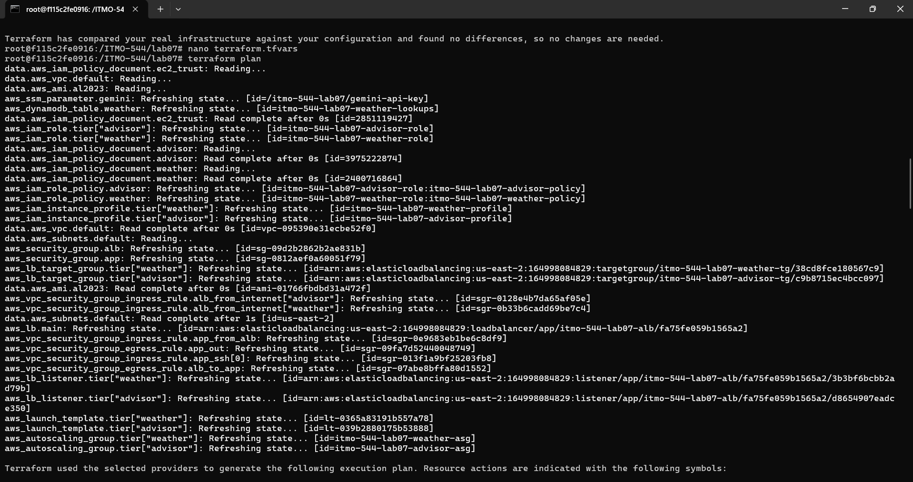

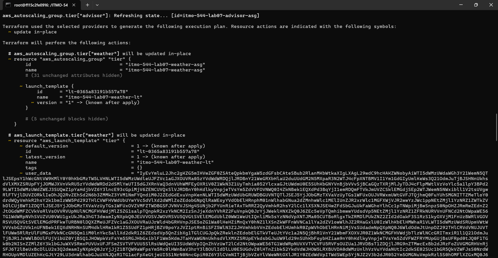

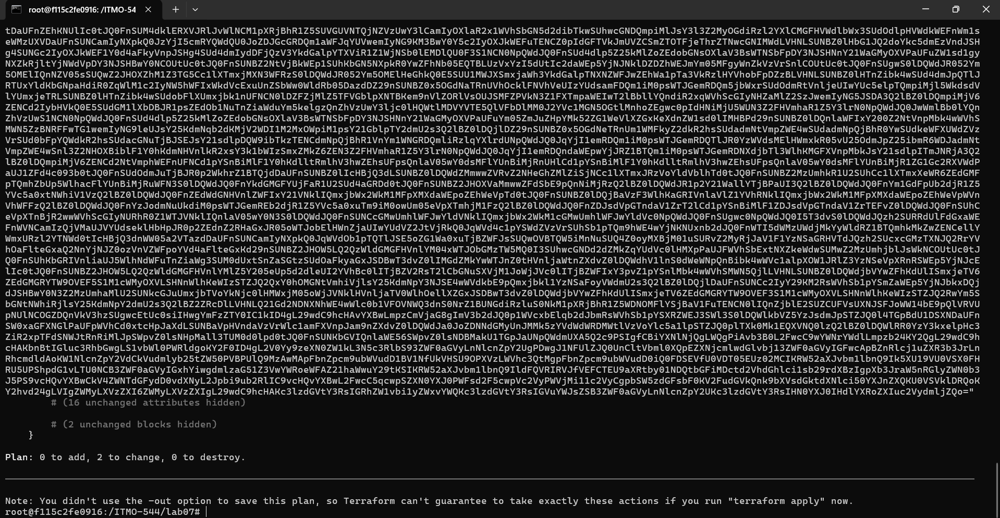

The instance refresh status and the new setting on the new instance:

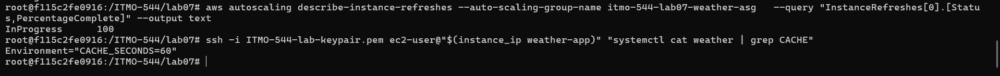

### Step 5. Cause drift and watch Terraform notice

The target group health check path changed by hand to /nope:

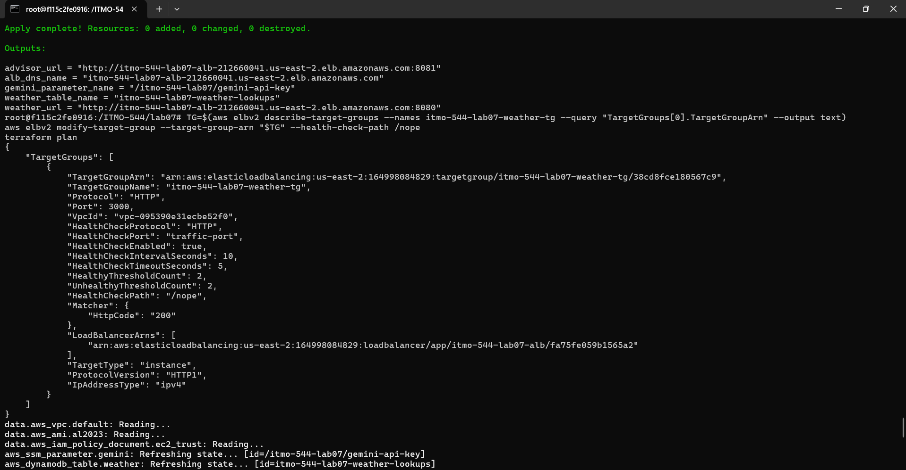

The drift plan:

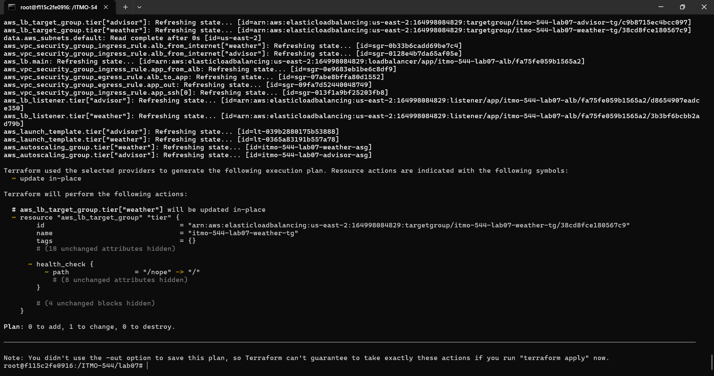

The path "/nope" was changed to "/" outside the Terraform, and terraform plan detected it and planned to revert it back, as it noted that the path had changed from ~ path = "/nope" -> "/" and Plan: 0 to add, 1 to change, 0 to destroy. 

7. Steps 6 and 7: the IAM simulator results with a sentence about the advisor tier, and the No changes plan, the grep -c count of 0 and the sentences about ignore_changes

### Step 6. Who can do what?

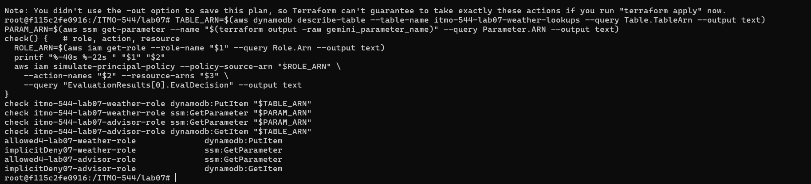

The weather role is allowed on the PutItem action for dynamodb, the ssm:GetParameter action on the weather role, and the ssm:GetParameter action on the advisor role, and the GetItem action on the advisor role is denied. If an attacker attacks to the advisor tier they are only able to read one of the parameters of the Gemini, and they do not gain access to the weather table, or to any other resource, but this Gemini key would still need to be replaced.

### Step 7. The key never touched Terraform

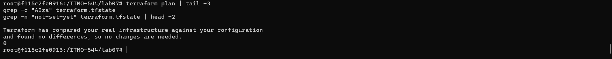

The plan says No changes even though the real Gemini key is stored in Parameter Store instead of not-set-yet. This is because ignore_changes = [value] tells Terraform to leave the value alone. The grep -c count of 0 shows that no text starting with AIza is in the state file, so the key never reached Terraform. The second grep for not-set-yet printed no lines in this run, so the placeholder was not found in the state either. Without ignore_changes, the next terraform apply would overwrite the real key with not-set-yet, and the advisor would quietly fall back to its rule-based answers.  

8. Steps 8 and 9: the fallback answers with the gemini_error journal line and a sentence about silent fallback, and the completed Lambda table with the answer to question 4

### Step 8. Break the key and watch the fallback

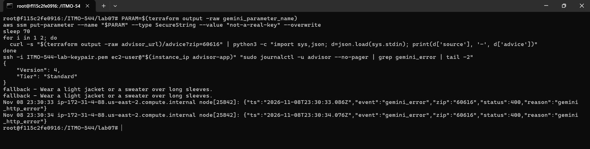

After the key was overwritten with not-a-real-key and the key cache expired, both answers came back with source fallback, and no request returned an error. The journal lines at 23:30:33 and 23:30:34 show "event":"gemini_error","status":400, which is Google rejecting the invalid key. The downside of a design that has no user visible error is that a broken key or expired key can go undetected for days because every request will get back a "normal" answer and the only indication would be a gemini_error log line that nobody reads.  

### Step 9. The Lambda exercise

The resources created because the advisor was run on an EC2 instance are the launch template with its user-data, the Auto Scaling group with the refresh of instances, the app security group with the rule for the port 3000 from the load balancer, the outbound rule, the SSH rule, and the AMI lookup, the target group's health check settings, and the instance role as an execution role. The only elements that would remain would be the SSM parameter, the advisor's read-one-secret policy, the load balancer with its security group, the listener on port 8081, the target group, the role, the outputs and the tags. The only thing new, aside from those items, would be the aws_lambda_function resource that packs the code into a Lambda, the Lambda permission that gives the load balancer permission to call the function, the target group that has the target type lambda.  

| Advisor on EC2 (this lab) | Advisor on Lambda | Effort moved to |
|---|---|---|
| Launch template and user-data | Replaced by an aws_lambda_function resource | AWS runs the servers |
| Auto Scaling Group and instance refresh | Not needed: Lambda scales per request, and publishing a new code version replaces the old one | AWS |
| App security group rule for port 3000 | Not needed for this tier. The load balancer needs a Lambda permission to invoke the function | An IAM permission instead of a network rule |
| Instance profile and role | Replaced by a Lambda execution role with the same read-one-secret policy | Least privilege still applies |
| Node.js install and systemd service | Not needed. The Lambda runtime provides Node.js, but Express is replaced by an event handler | AWS runtime, but the application code has to be rewritten |
| Health check and grace period | Not needed. There are no instances that can be unhealthy, and the target group uses a Lambda target | AWS |

Answer to question 4: The effort to create the resources in the correct order and to be sure they didn't already exist was eliminated by Terraform, and the effort of running the servers, patching the operating system and scaling was eliminated by Lambda, so that most of the resources in the first three lists are eliminated by Lambda and most of the resources in the last two lists are eliminated by Terraform. The upside is less machinery to describe, and the new problems adopted are cold starts which delays the first request, the time limit of a function, the need to rewrite the code for a Lambda event, and the more difficult testing of a handler, than a typical web server.  

9. Short answers: how Terraform is like AWS Lambda and where the comparison stops, what Terraform did not make easier, and the answers to the Section 13.1 review questions

### How Terraform is like AWS Lambda, and where the comparison stops

Terraform is like AWS Lambda because in both cases a small piece (a configuration or a function) is handed over and the platform does the repetitive work around it. Terraform works out the order, waits, and compares what exists with the code. Lambda handles servers, scaling and health checks. Both are also idempotent. The second terraform apply changed nothing, and running a Lambda function again with the same input gives the same result.

The comparison stops there because they do different jobs. Lambda is a service that runs the application code every time a request comes in. Terraform only builds the infrastructure before the application exists, and it never handles a request. Terraform also keeps a state file, and losing it is a serious problem. Lambda keeps nothing between runs.  

### What Terraform did not make easier

Terraform was not shorter. The 432 lines of Terraform are more than the 173 lines of lab06 Python, so the saving was in kinds of work, not in lines. Storing the real Gemini key stayed a one-time imperative CLI command, and the key had to be kept out of the files and the state on purpose with ignore_changes. Debugging the applications still needed SSH and the journal, because Terraform only describes the infrastructure and cannot tell whether the code works, and the Gemini problems were the same as in lab06. Cleanup also could not be proved from Terraform alone, since the tagging API still listed stale entries after the destroy.  

10. Step 10: the terraform destroy plan and total time, the cost estimate (hours multiplied by the hourly cost), and the verification commands showing nothing remains

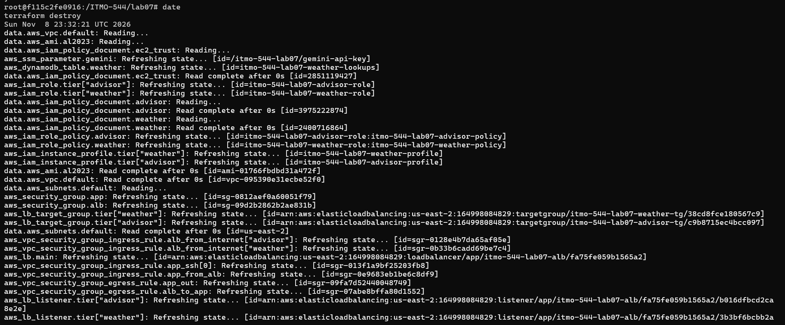

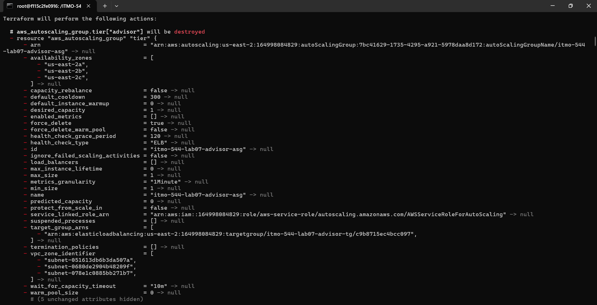

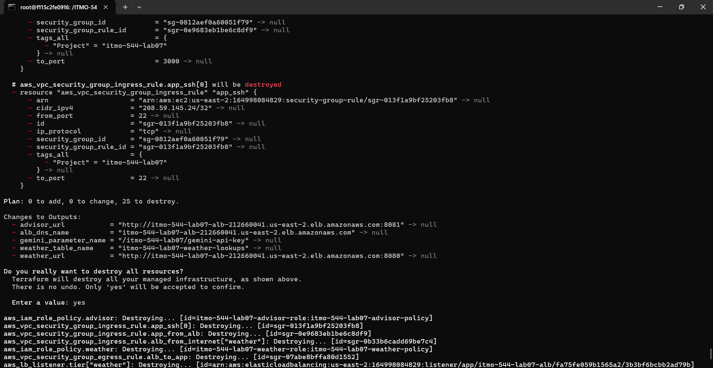

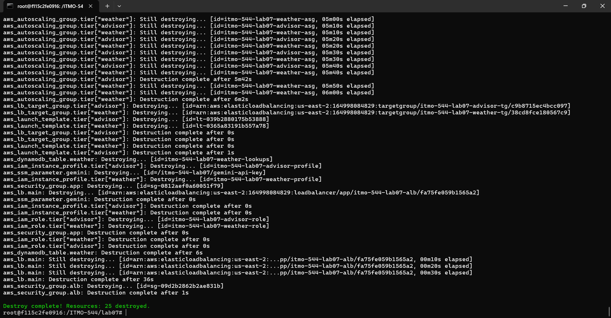

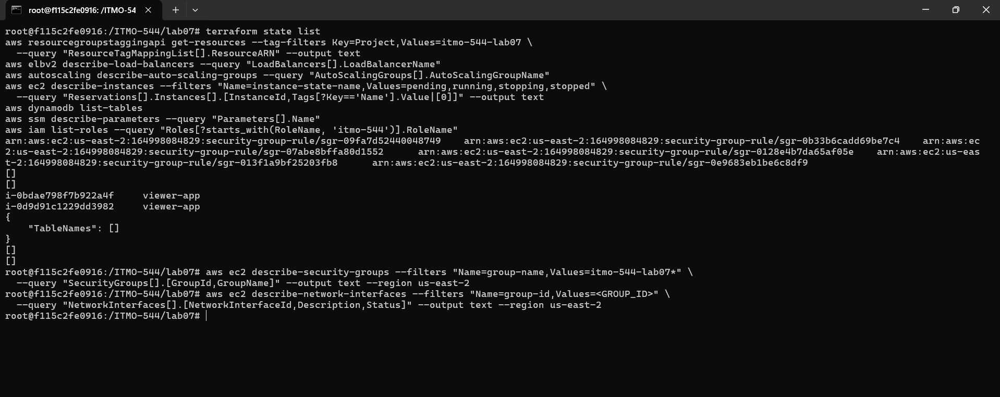